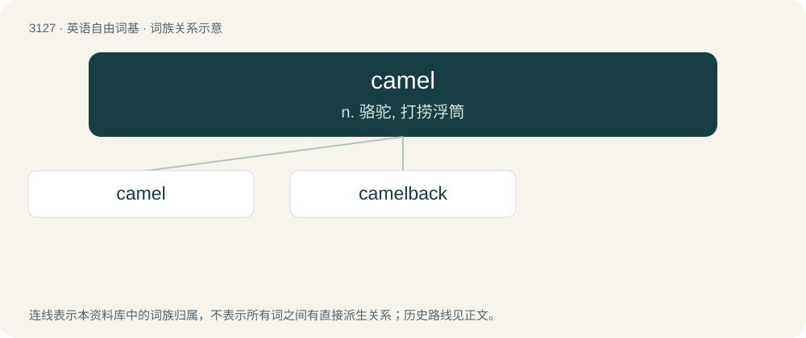

# 3230 · camel — n. 骆驼, 打捞浮筒

[总目录](../00_总目录_按常用程度.md)

**类型**：英语自由词基　｜　**来源语言**：见词源记录

## 核心含义与来源

- 核心含义：n. 骆驼, 打捞浮筒
- 英文含义：A mammalian beast of burden, much used in desert areas, of the genus Camelus.
- 词形：camel

**来源记录 1**（名词；A mammalian beast of burden, much used in desert areas, of the genus Camelus.）

From Middle English camel, through Old English camel and Old Northern French camel (Old French chamel, modern French chameau), from Latin camēlus, from Ancient Greek κάμηλος (kámēlos), from a Semitic source, ultimately from Proto-Semitic \*gamal-; compare Arabic جَمَل (jamal), Hebrew גמל (gamál), Aramaic ܓܡܠܐ (gamlā), Coptic ϭⲁⲙⲟⲩⲗ (čamoul). As a marine device, from Dutch. As an ethnic slur, short for camelfucker, camel jockey, etc.

## 词族图

## 单词速览（常用到不常用）

| 单词 | 音标 | 释义 |
|---|---|---|
| [camel](#w-1) | 英 /ˈkæml̩/；美 /ˈkæm(ə)l/ | n. 骆驼, 打捞浮筒 |
| [camelback](#w-2) | /ˈkæməlbæk/ | a. 骑在骆驼背上的；adv. 骑在骆驼背上地；n. 骆驼背, 一种翻新的橡胶 |

## 逐词详解

### 1. camel

**词性**：名词　｜　**音标**：英 /ˈkæml̩/；美 /ˈkæm(ə)l/

**中文释义**：n. 骆驼, 打捞浮筒

**英文义项**：A mammalian beast of burden, much used in desert areas, of the genus Camelus. / A light brownish color, like that of a camel (also called camel brown).

**词源与演化**：

From Middle English camel, through Old English camel and Old Northern French camel (Old French chamel, modern French chameau), from Latin camēlus, from Ancient Greek κάμηλος (kámēlos), from a Semitic source, ultimately from Proto-Semitic \*gamal-; compare Arabic جَمَل (jamal), Hebrew גמל (gamál), Aramaic ܓܡܠܐ (gamlā), Coptic ϭⲁⲙⲟⲩⲗ (čamoul). As a marine device, from Dutch. As an ethnic slur, short for camelfucker, camel jockey, etc.

**例句**：

> Don't act as if you were born in the year of Camel.

### 2. camelback

**词性**：名词　｜　**音标**：/ˈkæməlbæk/

**中文释义**：a. 骑在骆驼背上的；adv. 骑在骆驼背上地；n. 骆驼背, 一种翻新的橡胶

**英文义项**：The backs of camels. / A flexible water container worn on the back.

**构词拆分**：camel + back

**词源与演化**：

From camel + back. \]

**例句**：

> An empty camelback is a blessing and a curse: it is easy to carry, but it means you have no water.

该用例对应义项：A flexible water container worn on the back.
