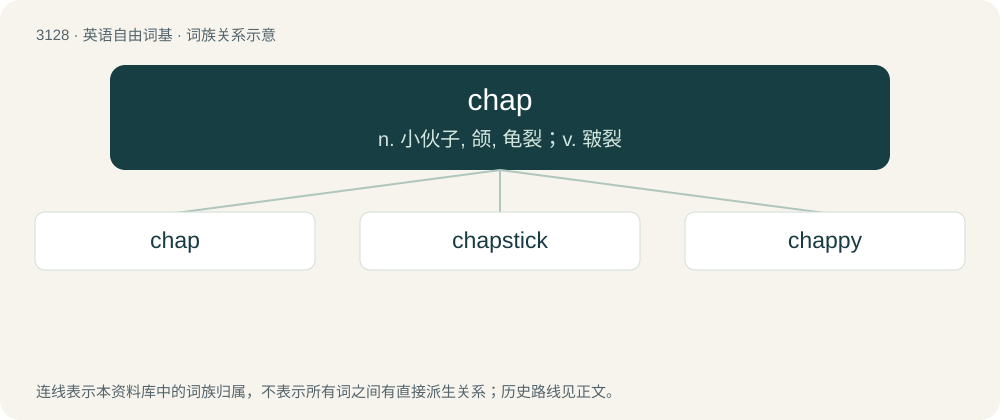

# 3231 · chap — n. 小伙子, 颌, 龟裂；v. 皲裂

[总目录](../00_总目录_按常用程度.md)

**类型**：英语自由词基　｜　**来源语言**：见词源记录

## 核心含义与来源

- 核心含义：n. 小伙子, 颌, 龟裂；v. 皲裂
- 英文含义：A man, a fellow.
- 词形：chap

**多个词源／构词路径**：同一拼写可能有不同来源；以下按词性和含义分别列出。

**来源记录 1**（名词；A man, a fellow.）

Clipping of chapman (“dealer, customer”) in 16th-century English.

**来源记录 2**（动词；Of the skin, to split or flake due to cold weather or dryness.）

From Middle English chappen (“to split open, burst, chap”), of uncertain origin. Compare Middle English choppen (“to chop”), Dutch kappen (“to cut, chop, hack”). Perhaps related to chip.

**来源记录 3**（名词；One of the jaws or cheeks of a vice, etc.）

From Northern English chafts (“jaws”). Compare also Middle English cheppe (“one side of the jaw, chap”).

## 词族图

## 单词速览（常用到不常用）

| 单词 | 音标 | 释义 |
|---|---|---|
| [chap](#w-1) | /t͡ʃæp/ | n. 小伙子, 颌, 龟裂；v. 皲裂 |
| [chapstick](#w-2) | 美 /ˈt͡ʃæpˌstɪk/ | n. 无色唇膏 |
| [chappy](#w-3) | /ˈt͡ʃæpi/ | n. 喜爱卖弄的人, 花花公子, 家伙, 小伙子；a. 皲裂的, 龟裂的 |

## 逐词详解

### 1. chap

**词性**：名词　｜　**音标**：/t͡ʃæp/

**中文释义**：n. 小伙子, 颌, 龟裂；v. 皲裂

**英文义项**：A man, a fellow. / A customer, a buyer.

**词源与演化**：

Clipping of chapman (“dealer, customer”) in 16th-century English.

**例句**：

> Who’s that chap over there?

该用例对应义项：A man, a fellow.

### 2. chapstick

**词性**：名词　｜　**音标**：美 /ˈt͡ʃæpˌstɪk/

**中文释义**：n. 无色唇膏

**英文义项**：Synonym of lip balm.

**构词拆分**：chap + stick

**词源与演化**：

Genericized trademark from ChapStick, a brand name, from chap + stick, since it is a stick that relieves chapped lips.

### 3. chappy

**词性**：名词　｜　**音标**：/ˈt͡ʃæpi/

**中文释义**：n. 喜爱卖弄的人, 花花公子, 家伙, 小伙子；a. 皲裂的, 龟裂的

**英文义项**：A chap; a fellow.

**构词拆分**：From chap + -y.

**词源与演化**：

From chap + -y.
