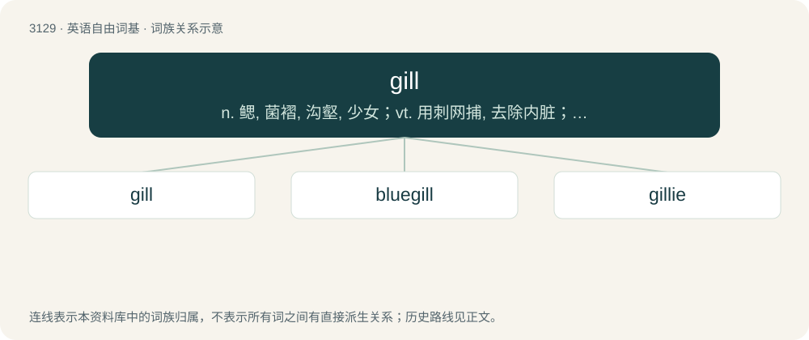

# 3233 · gill — n. 鳃, 菌褶, 沟壑, 少女；vt. 用刺网捕, 去除内脏；vi. 被刺网捕住

[总目录](../00_总目录_按常用程度.md)

**类型**：英语自由词基　｜　**来源语言**：见词源记录

## 核心含义与来源

- 核心含义：n. 鳃, 菌褶, 沟壑, 少女；vt. 用刺网捕, 去除内脏；vi. 被刺网捕住
- 英文含义：A breathing organ of fish and other aquatic animals.
- 词形：gill

**多个词源／构词路径**：同一拼写可能有不同来源；以下按词性和含义分别列出。

**来源记录 1**（名词；A breathing organ of fish and other aquatic animals.）

From Middle English gille, gylle (“gill”), of North Germanic origin, akin to Danish gælle, Swedish gäl, Norwegian gjelle, and further to Old Norse gjǫlnar (“lips”), which also may have had the meaning of "gills" (based on Old Danish fiskegæln (“gills”)). The Old Norse word has been suggested as deriving from Proto-Germanic \*gelunō (“jaw”), from Proto-Indo-European \*gʰel-, which would make it root-cognate to Ancient Greek χελύνη (khelúnē, “lip, jaw”), χεῖλος (kheîlos, “lip”). Displaced native Old English ċīe.

**来源记录 2**（名词；A drink measure for spirits and wine, a quarter of an imperial pint or near to that amount, but varying regionally.）

From Middle English gille, from Old French gille (“a wine measure”), from Medieval Latin gillo (“earthenware jar”).

**来源记录 3**（名词；A rivulet, small stream.）

From Middle English gille, from Old Norse gil.

**来源记录 4**（名词；A two-wheeled frame for transporting timber.）

Uncertain.

## 词族图

## 单词速览（常用到不常用）

| 单词 | 音标 | 释义 |
|---|---|---|
| [gill](#w-1) | /ɡɪl/ | n. 鳃, 菌褶, 沟壑, 少女；vt. 用刺网捕, 去除内脏；vi. 被刺网捕住 |
| [bluegill](#w-2) | /ˈbluːɡɪl/ | n. (美国密西西比河流域产的)浅蓝色食用大太阳鱼 |
| [gillie](#w-3) | 英 /ˈdʒɪli/；美 /ˈd͡ʒili/ | 【英文】A gill of an alcoholic drink. |

## 逐词详解

### 1. gill

**词性**：名词　｜　**音标**：/ɡɪl/

**中文释义**：n. 鳃, 菌褶, 沟壑, 少女；vt. 用刺网捕, 去除内脏；vi. 被刺网捕住

**英文义项**：A breathing organ of fish and other aquatic animals. / A gill slit or gill cover.

**词源与演化**：

From Middle English gille, gylle (“gill”), of North Germanic origin, akin to Danish gælle, Swedish gäl, Norwegian gjelle, and further to Old Norse gjǫlnar (“lips”), which also may have had the meaning of "gills" (based on Old Danish fiskegæln (“gills”)). The Old Norse word has been suggested as deriving from Proto-Germanic \*gelunō (“jaw”), from Proto-Indo-European \*gʰel-, which would make it root-cognate to Ancient Greek χελύνη (khelúnē, “lip, jaw”), χεῖλος (kheîlos, “lip”). Displaced native Old English ċīe.

**例句**：

> Gill nets are designed to catch a fish by the gills.

该用例对应义项：A gill slit or gill cover.

### 2. bluegill

**词性**：名词　｜　**音标**：/ˈbluːɡɪl/

**中文释义**：n. (美国密西西比河流域产的)浅蓝色食用大太阳鱼

**英文义项**：Any member of the species Lepomis macrochirus of North American sunfish.

**构词拆分**：blue + gill

**词源与演化**：

From blue + gill.

### 3. gillie

**词性**：名词　｜　**音标**：英 /ˈdʒɪli/；美 /ˈd͡ʒili/

**英文义项**：A gill of an alcoholic drink.

**构词拆分**：gill (“drink measure for spirits”) + -ie

**词源与演化**：

From gill (“drink measure for spirits”) + -ie; probably a nonce word coined by Scottish poet Robert Burns (1759–1796) to maintain the rhyme in a poem entitled On a Scotch Bard Gone to the West Indies, first published in 1786: see the quotation.
