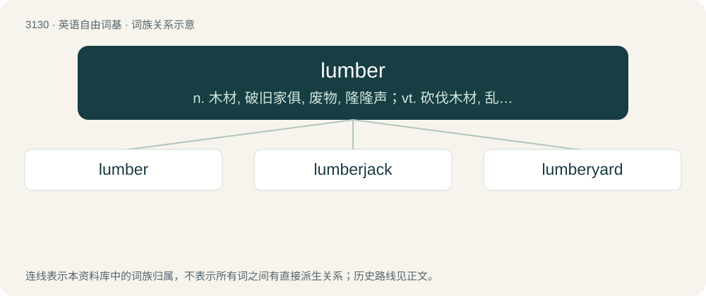

# 3234 · lumber — n. 木材, 破旧家俱, 废物, 隆隆声；vt. 砍伐木材, 乱堆；vi. 笨拙地移动, 喧闹地向前走, 隆隆地移动

[总目录](../00_总目录_按常用程度.md)

**类型**：英语自由词基　｜　**来源语言**：见词源记录

## 核心含义与来源

- 核心含义：n. 木材, 破旧家俱, 废物, 隆隆声；vt. 砍伐木材, 乱堆；vi. 笨拙地移动, 喧闹地向前走, 隆隆地移动
- 英文含义：Wood sawn into planks or otherwise prepared for sale or use, especially as a building material.
- 词形：lumber

**来源记录 1**（名词；Wood sawn into planks or otherwise prepared for sale or use, especially as a building material.）

Exact origin unknown. The earliest recorded reference for the noun was to heavy, useless objects such as old, discarded furniture. Perhaps from the verb lumber in reference to meaning "awkward to move"; Online Etymological Dictionary thinks this may derive from the same root as lame. Possibly influenced by Lumbar, an obsolete variant of Lombard, the Italian immigrant class known for being pawnbrokers and money-lenders in early England. Compare English lumpish.

## 词族图

## 单词速览（常用到不常用）

| 单词 | 音标 | 释义 |
|---|---|---|
| [lumber](#w-1) | 英 /ˈlʌm.bə/；美 /ˈlʌm.bɚ/ | n. 木材, 破旧家俱, 废物, 隆隆声；vt. 砍伐木材, 乱堆；vi. 笨拙地移动, 喧闹地向前走, 隆隆地移动 |
| [lumberjack](#w-2) | 英 /ˈlʌm.bə.d͡ʒæk/；美 /ˈlʌm.bɚ.d͡ʒæk/ | n. 伐木工人, 板材上垛装置 |
| [lumberyard](#w-3) | 美 /ˈlʌmbɚˌjɑɹd/ | n. 木材堆置场, 木场 |

## 逐词详解

### 1. lumber

**词性**：动词　｜　**音标**：英 /ˈlʌm.bə/；美 /ˈlʌm.bɚ/

**中文释义**：n. 木材, 破旧家俱, 废物, 隆隆声；vt. 砍伐木材, 乱堆；vi. 笨拙地移动, 喧闹地向前走, 隆隆地移动

**英文义项**：To move clumsily and heavily; to move slowly. / To load down with things, to fill, to encumber, to impose an unwanted burden on.

**词源与演化**：

Exact origin unknown. The earliest recorded reference for the noun was to heavy, useless objects such as old, discarded furniture. Perhaps from the verb lumber in reference to meaning "awkward to move"; Online Etymological Dictionary thinks this may derive from the same root as lame. Possibly influenced by Lumbar, an obsolete variant of Lombard, the Italian immigrant class known for being pawnbrokers and money-lenders in early England. Compare English lumpish.

**例句**：

> I got lumbered with that boring woman all afternoon.

该用例对应义项：To load down with things, to fill, to encumber, to impose an unwanted burden on.

### 2. lumberjack

**词性**：名词　｜　**音标**：英 /ˈlʌm.bə.d͡ʒæk/；美 /ˈlʌm.bɚ.d͡ʒæk/

**中文释义**：n. 伐木工人, 板材上垛装置

**英文义项**：A person whose work is to fell trees. / A lumberjacket.

**构词拆分**：lumber + jack

**词源与演化**：

From lumber + jack, of Canadian origin.

**例句**：

> The lumberjack confessed to the IBAMA that he'd chopped down a protected tree.

### 3. lumberyard

**词性**：名词　｜　**音标**：美 /ˈlʌmbɚˌjɑɹd/

**中文释义**：n. 木材堆置场, 木场

**英文义项**：A facility dedicated to the preparation and sale of lumber.

**构词拆分**：lumber + yard

**词源与演化**：

From lumber + yard.

**例句**：

> I'll just go to the lumberyard and buy some more two by fours so we can finish building this.

该用例对应义项：A facility dedicated to the preparation and sale of lumber.
