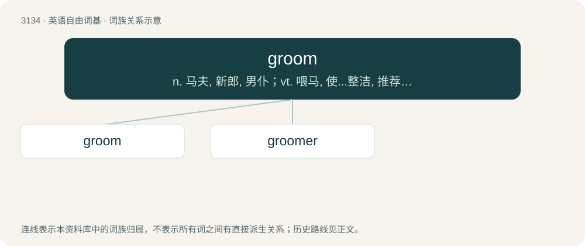

# 3235 · groom — n. 马夫, 新郎, 男仆；vt. 喂马, 使...整洁, 推荐；vi. 打扮, 穿戴

[总目录](../00_总目录_按常用程度.md)

**类型**：英语自由词基　｜　**来源语言**：见词源记录

## 核心含义与来源

- 核心含义：n. 马夫, 新郎, 男仆；vt. 喂马, 使...整洁, 推荐；vi. 打扮, 穿戴
- 英文含义：A man who is about to marry.
- 词形：groom

**多个词源／构词路径**：同一拼写可能有不同来源；以下按词性和含义分别列出。

**来源记录 1**（名词；A man who is about to marry.）

1604, short for bridegroom (“husband-to-be”), from Middle English brydgrome, alteration (with intrusive r) of earlier bridegome (“bridegroom”), from Old English brȳdguma (“bridegroom”), from brȳd (“bride”) + guma (“man, hero”). In Middle English, the second element was re-analyzed as or influenced by grom, grome (“attendant”). Guma derives from Proto-Germanic \*gumô (“man, person”), from Proto-Indo-European \*dʰǵʰm̥mō; it is cognate to Icelandic gumi (cf. Icelandic brúðgumi) and Norwegian gume and, ultimately, human.

**来源记录 2**（名词；A person who looks after horses.）

From Middle English grom, grome (“man-child, boy, youth”), of uncertain origin. Apparently related to Middle Dutch grom (“boy”), Old Icelandic grómr, gromr (“man, manservant, boy”), Old French gromme (“manservant”), and also to Middle Dutch grom (“fish guts”), Middle Low German grôm (“fish guts”), from the same Proto-Germanic root. Possibly from Old English \*grōm, from Proto-West Germanic \*grōm (“swollen belly, stomach tumour, womb-child, fish roe, fish guts”), from Proto-Germanic \*grōaną (“to grow”). Alternative etymology describes Middle English grom, grome as an alteration of gome (“man”) with an intrusive r (also found in bridegroom, hoarse, cartridge, etc.), with the Middle Dutch and Old Icelandic cognates following similar variation of their respective forms.

## 词族图

## 单词速览（常用到不常用）

| 单词 | 音标 | 释义 |
|---|---|---|
| [groom](#w-1) | 英 /ɡɹuːm/；美 /ɡɹum/ | n. 马夫, 新郎, 男仆；vt. 喂马, 使...整洁, 推荐；vi. 打扮, 穿戴 |
| [groomer](#w-2) | 英 /ˈɡɹuː.mə/；美 /ˈɡɹu.məɹ/ | 美容师 |

## 逐词详解

### 1. groom

**词性**：名词　｜　**音标**：英 /ɡɹuːm/；美 /ɡɹum/

**中文释义**：n. 马夫, 新郎, 男仆；vt. 喂马, 使...整洁, 推荐；vi. 打扮, 穿戴

**英文义项**：A man who is about to marry.

**词源与演化**：

1604, short for bridegroom (“husband-to-be”), from Middle English brydgrome, alteration (with intrusive r) of earlier bridegome (“bridegroom”), from Old English brȳdguma (“bridegroom”), from brȳd (“bride”) + guma (“man, hero”). In Middle English, the second element was re-analyzed as or influenced by grom, grome (“attendant”). Guma derives from Proto-Germanic \*gumô (“man, person”), from Proto-Indo-European \*dʰǵʰm̥mō; it is cognate to Icelandic gumi (cf. Icelandic brúðgumi) and Norwegian gume and, ultimately, human.

**例句**：

> I'd like to dedicate this next song to the bride and groom.

### 2. groomer

**词性**：名词　｜　**音标**：英 /ˈɡɹuː.mə/；美 /ˈɡɹu.məɹ/

**中文释义**：美容师

**英文义项**：A person who or an animal (the groomee) which cares for an animal by brushing and cleaning. / A person who takes care for another person's appearance and clothing.

**构词拆分**：groom + -er

**词源与演化**：

From groom + -er.

**例句**：

> Once you've done the training and assisted with 10 trimmings, you'll be a fully fledged dog groomer.
