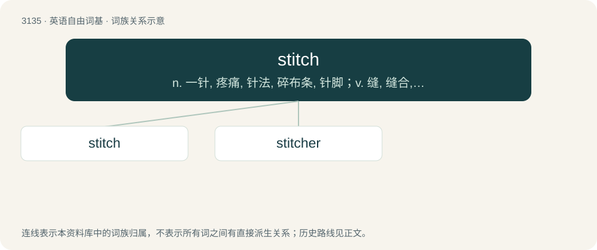

# 3236 · stitch — n. 一针, 疼痛, 针法, 碎布条, 针脚；v. 缝, 缝合, 装订

[总目录](../00_总目录_按常用程度.md)

**类型**：英语自由词基　｜　**来源语言**：见词源记录

## 核心含义与来源

- 核心含义：n. 一针, 疼痛, 针法, 碎布条, 针脚；v. 缝, 缝合, 装订
- 英文含义：A single pass of a needle in sewing; the loop or turn of the thread thus made.
- 词形：stitch

**多个词源／构词路径**：同一拼写可能有不同来源；以下按词性和含义分别列出。

**来源记录 1**（名词；A single pass of a needle in sewing; the loop or turn of the thread thus made.）

From Middle English stiche, from Old English stiċe (“a prick, puncture, stab, thrust with a pointed implement, pricking sensation, stitch, pain in the side, sting”), from Proto-West Germanic \*stiki, from Proto-Germanic \*stikiz (“prick, piercing, stitch”), from Proto-Indo-European \*(s)teyg- (“to stab, pierce”). Cognate with Dutch steek (“prick, stitch”), German Stich (“a prick, piercing, stitch”), Old English stician (“to stick, stab, pierce, prick”). More at stick. Via PIE cognate with Czech steh, Polish ścieg, Russian стежо́к (stežók).

**来源记录 2**（动词；To form stitches in; especially, to sew in such a manner as to show on the surface a continuous line of stitches.）

From Middle English sticchen, stichen, from Old English \*stiċċan, stiċċian, from Proto-Germanic \*stikjaną (“to stab, stick, prick”), influenced by the noun (see above).

## 词族图

## 单词速览（常用到不常用）

| 单词 | 音标 | 释义 |
|---|---|---|
| [stitch](#w-1) | 英 /stɪt͡ʃ/ | n. 一针, 疼痛, 针法, 碎布条, 针脚；v. 缝, 缝合, 装订 |
| [stitcher](#w-2) | /ˈstitʃə/ | 钉书机 |

## 逐词详解

### 1. stitch

**词性**：名词　｜　**音标**：英 /stɪt͡ʃ/

**中文释义**：n. 一针, 疼痛, 针法, 碎布条, 针脚；v. 缝, 缝合, 装订

**英文义项**：A single pass of a needle in sewing; the loop or turn of the thread thus made. / A single pass of a surgical suture (to sew the edges of a wound together)

**词源与演化**：

From Middle English stiche, from Old English stiċe (“a prick, puncture, stab, thrust with a pointed implement, pricking sensation, stitch, pain in the side, sting”), from Proto-West Germanic \*stiki, from Proto-Germanic \*stikiz (“prick, piercing, stitch”), from Proto-Indo-European \*(s)teyg- (“to stab, pierce”). Cognate with Dutch steek (“prick, stitch”), German Stich (“a prick, piercing, stitch”), Old English stician (“to stick, stab, pierce, prick”). More at stick. Via PIE cognate with Czech steh, Polish ścieg, Russian стежо́к (stežók).

**例句**：

> I cut myself badly while cooking and needed to go to hospital to get stitches.

该用例对应义项：A single pass of a surgical suture (to sew the edges of a wound together)

### 2. stitcher

**词性**：名词　｜　**音标**：/ˈstitʃə/

**中文释义**：钉书机

**英文义项**：One who stitches.

**构词拆分**：stitch + -er

**词源与演化**：

From stitch + -er.
