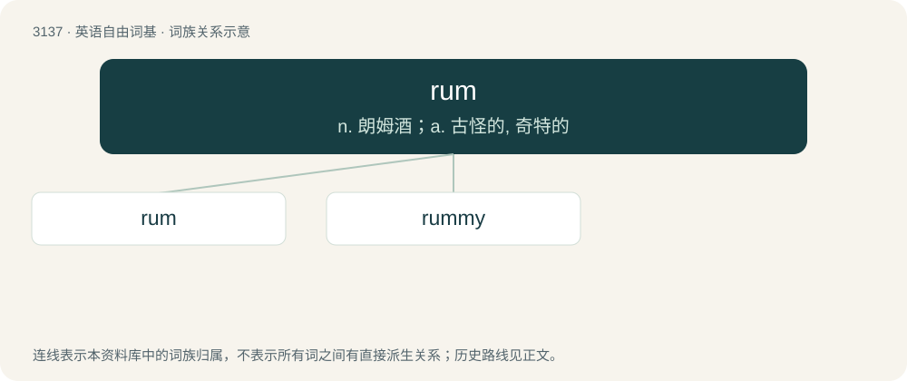

# 3237 · rum — n. 朗姆酒；a. 古怪的, 奇特的

[总目录](../00_总目录_按常用程度.md)

**类型**：英语自由词基　｜　**来源语言**：见词源记录

## 核心含义与来源

- 核心含义：n. 朗姆酒；a. 古怪的, 奇特的
- 英文含义：A spirit distilled from various preparations of sugarcane, particularly fermented cane sugar and molasses.
- 词形：rum

**多个词源／构词路径**：同一拼写可能有不同来源；以下按词性和含义分别列出。

**来源记录 1**（名词；A spirit distilled from various preparations of sugarcane, particularly fermented cane sugar and molasses.）

In common use since at least 1654, of uncertain origin. Theories include: \* that it is a shortening of rumbullion or rumbustion, names for rum also attested in the Caribbean during the mid-17th century, \* that it derives from rummer, from Dutch roemer, \* that it is from a Romani word for "strong, potent" which is (perhaps) the source of ramboozle and rumfustian (however, these drinks were not originally made with rum), \* that it derives from rum ("fine, good") or from the last syllable of Latin saccharum (given the harsh taste of earlier rum, this origin is now considered unlikely)

**来源记录 2**（形容词；Strange, peculiar.）

From the earlier form rome (“good”, slang); possibly of Romani origin; compare rom.

**来源记录 3**（名词；The card game rummy.）

Shortening of rummy.

## 词族图

## 单词速览（常用到不常用）

| 单词 | 音标 | 释义 |
|---|---|---|
| [rum](#w-1) | 英 /ɹʌm/ | n. 朗姆酒；a. 古怪的, 奇特的 |
| [rummy](#w-2) | 英 /ˈɹʌmɪ/；美 /ˈɹʌmi/ | 【英文】Resembling or tasting of rum. |

## 逐词详解

### 1. rum

**词性**：名词　｜　**音标**：英 /ɹʌm/

**中文释义**：n. 朗姆酒；a. 古怪的, 奇特的

**英文义项**：A spirit distilled from various preparations of sugarcane, particularly fermented cane sugar and molasses. / A serving of rum.

**词源与演化**：

In common use since at least 1654, of uncertain origin. Theories include: \* that it is a shortening of rumbullion or rumbustion, names for rum also attested in the Caribbean during the mid-17th century, \* that it derives from rummer, from Dutch roemer, \* that it is from a Romani word for "strong, potent" which is (perhaps) the source of ramboozle and rumfustian (however, these drinks were not originally made with rum), \* that it derives from rum ("fine, good") or from the last syllable of Latin saccharum (given the harsh taste of earlier rum, this origin is now considered unlikely)

**例句**：

> The Royal Navy used to issue a rum ration to sailors.

该用例对应义项：A spirit distilled from various preparations of sugarcane, particularly fermented cane sugar and molasses.

### 2. rummy

**词性**：形容词　｜　**音标**：英 /ˈɹʌmɪ/；美 /ˈɹʌmi/

**英文义项**：Resembling or tasting of rum. / Peculiar; odd.

**构词拆分**：From rum + -y.

**词源与演化**：

From rum + -y.

**用法示例／搭配（非完整句）**：

> a rummy flavour

该用例对应义项：Resembling or tasting of rum.
