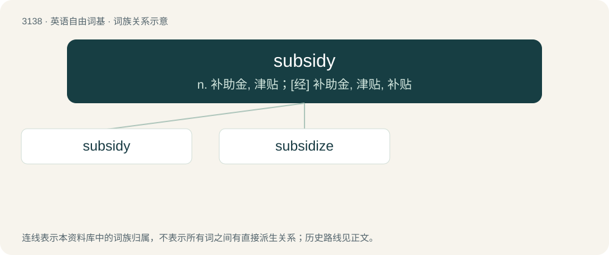

# 3238 · subsidy — n. 补助金, 津贴；\[经\] 补助金, 津贴, 补贴

[总目录](../00_总目录_按常用程度.md)

**类型**：英语自由词基　｜　**来源语言**：见词源记录

## 核心含义与来源

- 核心含义：n. 补助金, 津贴；\[经\] 补助金, 津贴, 补贴
- 英文含义：Financial support or assistance, such as a grant.
- 词形：subsidy

**来源记录 1**（名词；Financial support or assistance, such as a grant.）

From Middle English subsidy, subsidie, from Anglo-Norman subsidee, subsidie, from Old French subside, from Latin subsidium (support, assistance), from subsido from sub- (“below”) + sīdō (“sit”).

## 词族图

## 单词速览（常用到不常用）

| 单词 | 音标 | 释义 |
|---|---|---|
| [subsidy](#w-1) | 英 /ˈsʌbsɪdi/ | n. 补助金, 津贴；\[经\] 补助金, 津贴, 补贴 |
| [subsidize](#w-2) | 英 /ˈsʌbsɪdaɪz/ | vt. 补助, 资助, 贿赂；\[经\] 资助, 津贴, 给...补助金 |

## 逐词详解

### 1. subsidy

**词性**：名词　｜　**音标**：英 /ˈsʌbsɪdi/

**中文释义**：n. 补助金, 津贴；\[经\] 补助金, 津贴, 补贴

**英文义项**：Financial support or assistance, such as a grant. / Money granted by parliament to the British Crown.

**词源与演化**：

From Middle English subsidy, subsidie, from Anglo-Norman subsidee, subsidie, from Old French subside, from Latin subsidium (support, assistance), from subsido from sub- (“below”) + sīdō (“sit”).

**例句**：

> A subsidy for research in artificial intelligence.

该用例对应义项：a grant paid by a government to an enterprise that benefits the public

### 2. subsidize

**词性**：动词　｜　**音标**：英 /ˈsʌbsɪdaɪz/

**中文释义**：vt. 补助, 资助, 贿赂；\[经\] 资助, 津贴, 给...补助金

**英文义项**：To assist (someone or something) by granting a subsidy.

**构词拆分**：subsidy + -ize

**词源与演化**：

From subsidy + -ize.

**例句**：

> The city should subsidize small businesses in industries with large overhead costs.
