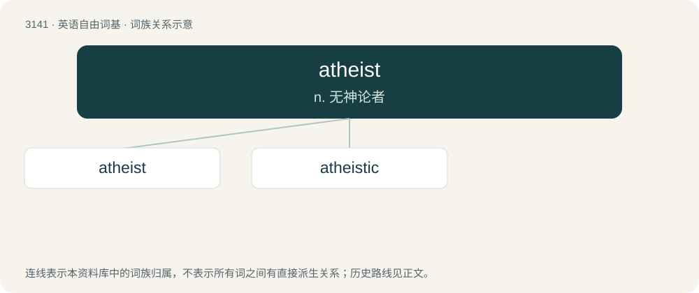

# 3241 · atheist — n. 无神论者

[总目录](../00_总目录_按常用程度.md)

**类型**：英语自由词基　｜　**来源语言**：见词源记录

## 核心含义与来源

- 核心含义：n. 无神论者
- 英文含义：A person who does not believe in deities or gods.
- 词形：atheist

**来源记录 1**（名词；A person who does not believe in deities or gods.）

From Middle French athéiste (athée + -iste), from Latin atheos, from Ancient Greek ἄθεος (átheos, “godless, without god”), from ἀ- (a-, “without”) + θεός (theós, “god”).

## 词族图

## 单词速览（常用到不常用）

| 单词 | 音标 | 释义 |
|---|---|---|
| [atheist](#w-1) | /ˈeɪ.θi.ɪst/ | n. 无神论者 |
| [atheistic](#w-2) | /.eiθiˈistik/ | a. 无神论的, 无神论者的 |

## 逐词详解

### 1. atheist

**词性**：名词　｜　**音标**：/ˈeɪ.θi.ɪst/

**中文释义**：n. 无神论者

**英文义项**：A person who does not believe in deities or gods. / A person who is certain that no deities exist or who thinks that the existence of deities can be disproven.

**构词拆分**：a- + theist

**词源与演化**：

From Middle French athéiste (athée + -iste), from Latin atheos, from Ancient Greek ἄθεος (átheos, “godless, without god”), from ἀ- (a-, “without”) + θεός (theós, “god”).

**例句**：

> When I said I was an atheist she looked down on me.

### 2. atheistic

**词性**：形容词　｜　**音标**：/.eiθiˈistik/

**中文释义**：a. 无神论的, 无神论者的

**英文义项**：Of or relating to atheists or atheism.

**构词拆分**：atheist + -ic

**词源与演化**：

From atheist + -ic.

**例句**：

> Public religious worship was not allowed under the atheistic communist state.
