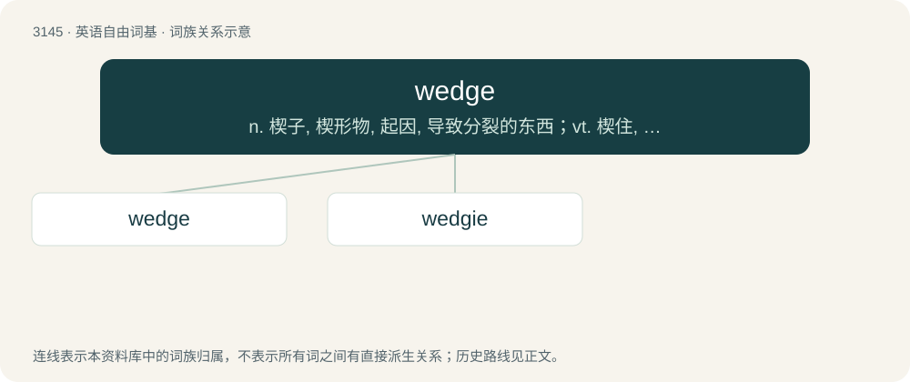

# 3247 · wedge — n. 楔子, 楔形物, 起因, 导致分裂的东西；vt. 楔住, 挤进, 楔入；vi. 楔入, 挤进

[总目录](../00_总目录_按常用程度.md)

**类型**：英语自由词基　｜　**来源语言**：见词源记录

## 核心含义与来源

- 核心含义：n. 楔子, 楔形物, 起因, 导致分裂的东西；vt. 楔住, 挤进, 楔入；vi. 楔入, 挤进
- 英文含义：One of the simple machines; a piece of material, such as metal or wood, thick at one edge and tapered to a thin edge at the other for insertion in a narrow crevice, used for splitting, tightening, securing, or levering.
- 词形：wedge

**多个词源／构词路径**：同一拼写可能有不同来源；以下按词性和含义分别列出。

**来源记录 1**（名词；One of the simple machines; a piece of material, such as metal or wood, thick at one edge and tapered to a thin edge at the other for insertion in a narrow crevice, used for splitting, tightening, securing, or levering.）

From Middle English wegge (“wedge”), from Old English weċġ (“wedge”), from Proto-West Germanic \*wagi, from Proto-Germanic \*wagjaz.

**来源记录 2**（名词；The person whose name stands lowest on the list of the classical tripos.）

From Wedgewood, surname of the person who occupied this position on the first list of 1828.

## 词族图

## 单词速览（常用到不常用）

| 单词 | 音标 | 释义 |
|---|---|---|
| [wedge](#w-1) | 英 /wɛd͡ʒ/ | n. 楔子, 楔形物, 起因, 导致分裂的东西；vt. 楔住, 挤进, 楔入；vi. 楔入, 挤进 |
| [wedgie](#w-2) | 英 /ˈwɛdʒ.i/ | n. 楔形后跟的女鞋 |

## 逐词详解

### 1. wedge

**词性**：名词　｜　**音标**：英 /wɛd͡ʒ/

**中文释义**：n. 楔子, 楔形物, 起因, 导致分裂的东西；vt. 楔住, 挤进, 楔入；vi. 楔入, 挤进

**英文义项**：One of the simple machines; a piece of material, such as metal or wood, thick at one edge and tapered to a thin edge at the other for insertion in a narrow crevice, used for splitting, tightening, securing, or levering. / A piece (of food, metal, wood etc.) having this shape.

**词源与演化**：

From Middle English wegge (“wedge”), from Old English weċġ (“wedge”), from Proto-West Germanic \*wagi, from Proto-Germanic \*wagjaz.

**例句**：

> We ordered a box of baked potato wedges with our pizza, and an iceberg wedge as our side salad.

该用例对应义项：A piece (of food, metal, wood etc.) having this shape.

### 2. wedgie

**词性**：名词　｜　**音标**：英 /ˈwɛdʒ.i/

**中文释义**：n. 楔形后跟的女鞋

**英文义项**：A wedge-heeled shoe. / A prank in which a person's underpants are pulled up sharply from behind in order to wedge the clothing uncomfortably between the person's buttocks.

**构词拆分**：From wedge + -ie.

**词源与演化**：

From wedge + -ie.
