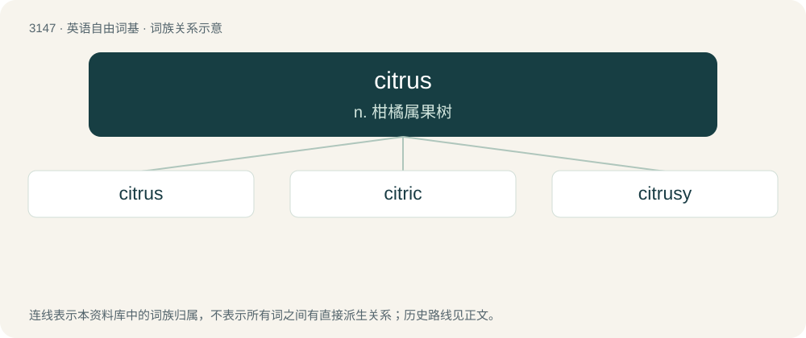

# 3249 · citrus — n. 柑橘属果树

[总目录](../00_总目录_按常用程度.md)

**类型**：英语自由词基　｜　**来源语言**：见词源记录

## 核心含义与来源

- 核心含义：n. 柑橘属果树
- 英文含义：Any of several shrubs or trees of the genus Citrus in the family Rutaceae.
- 词形：citrus

**来源记录 1**（名词；Any of several shrubs or trees of the genus Citrus in the family Rutaceae.）

From Latin citrus (“a citron tree, thuja”), probably via Etruscan from Ancient Greek κέδρος (kédros); compare Middle English citurtre, cytyr tre. Thus a possible doublet of cedar.

## 词族图

## 单词速览（常用到不常用）

| 单词 | 音标 | 释义 |
|---|---|---|
| [citrus](#w-1) | /ˈsɪtɹəs/ | n. 柑橘属果树 |
| [citric](#w-2) | /ˈsɪtɹɪk/ | a. 柠檬的, 取自柠檬的 |
| [citrusy](#w-3) | /ˈsɪtɹəsi/ | 【英文】Resembling a citrus fruit in taste or aroma. |

## 逐词详解

### 1. citrus

**词性**：名词　｜　**音标**：/ˈsɪtɹəs/

**中文释义**：n. 柑橘属果树

**英文义项**：Any of several shrubs or trees of the genus Citrus in the family Rutaceae. / The fruit of such plants, generally spherical, oblate, or prolate, consisting of an outer glandular skin (called zest), an inner white skin (called pith or albedo), and generally between 8 and 16 sectors filled with pulp consisting of cells with one end attached to the inner skin. Citrus fruits include orange, grapefruit, lemon, lime, and citron.

**词源与演化**：

From Latin citrus (“a citron tree, thuja”), probably via Etruscan from Ancient Greek κέδρος (kédros); compare Middle English citurtre, cytyr tre. Thus a possible doublet of cedar.

**例句**：

> Regular use of citrus fruit will shrink pores and make the skin feel fresh.

### 2. citric

**词性**：形容词　｜　**音标**：/ˈsɪtɹɪk/

**中文释义**：a. 柠檬的, 取自柠檬的

**英文义项**：Of, pertaining to, or derived from, citrus fruit.

**构词拆分**：citrus + -ic

**词源与演化**：

From citrus + -ic.

**例句**：

> If you're worried about your socks smelling, dipping them in citric acid solution might do the trick.

### 3. citrusy

**词性**：形容词　｜　**音标**：/ˈsɪtɹəsi/

**英文义项**：Resembling a citrus fruit in taste or aroma.

**构词拆分**：citrus + -y

**词源与演化**：

From citrus + -y.

**例句**：

> I love the citrusy taste of Earl Grey tea!
