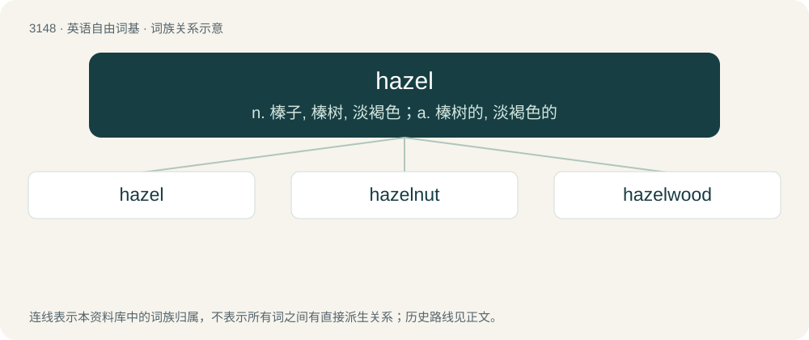

# 3250 · hazel — n. 榛子, 榛树, 淡褐色；a. 榛树的, 淡褐色的

[总目录](../00_总目录_按常用程度.md)

**类型**：英语自由词基　｜　**来源语言**：见词源记录

## 核心含义与来源

- 核心含义：n. 榛子, 榛树, 淡褐色；a. 榛树的, 淡褐色的
- 英文含义：A tree or shrub of the genus Corylus, bearing edible nuts called hazelnuts or filberts.
- 词形：hazel

**来源记录 1**（名词；A tree or shrub of the genus Corylus, bearing edible nuts called hazelnuts or filberts.）

From Middle English hasel, from Old English hæsl (“hazel, shrub”), from Proto-West Germanic \*hasl, from Proto-Germanic \*haslaz (“hazel”), from Proto-Indo-European \*kóslos (“hazel”). Cognates Cognate with Yola hawlse (“hazel”), Dutch hazel, hazelaar (“hazel”), German Hasel (“hazel”), Vilamovian hozuł (“hazel”), Danish, Norwegian Bokmål, and Swedish hassel (“hazel”), Icelandic hesli (“hazel”), Norwegian Nynorsk hasl, hassel (“hazel”); also Latin corulus, corylus (“hazel”), Irish call, coll (“hazel”), Manx coull (“hazel”), Scottish Gaelic coll (“hazel”), Welsh cyll (“hazel trees”).

## 词族图

## 单词速览（常用到不常用）

| 单词 | 音标 | 释义 |
|---|---|---|
| [hazel](#w-1) | /ˈheɪzəl/ | n. 榛子, 榛树, 淡褐色；a. 榛树的, 淡褐色的 |
| [hazelnut](#w-2) | 英 /ˈheɪzəlnʌt/；美 /ˈheɪzəlˌnʌt/ | n. 榛实；\[医\] 榛实 |
| [hazelwood](#w-3) | /ˈheɪzəlwʊd/ | 【英文】The wood of the hazel. |

## 逐词详解

### 1. hazel

**词性**：名词　｜　**音标**：/ˈheɪzəl/

**中文释义**：n. 榛子, 榛树, 淡褐色；a. 榛树的, 淡褐色的

**英文义项**：A tree or shrub of the genus Corylus, bearing edible nuts called hazelnuts or filberts. / The nut of the hazel tree.

**词源与演化**：

From Middle English hasel, from Old English hæsl (“hazel, shrub”), from Proto-West Germanic \*hasl, from Proto-Germanic \*haslaz (“hazel”), from Proto-Indo-European \*kóslos (“hazel”). Cognates Cognate with Yola hawlse (“hazel”), Dutch hazel, hazelaar (“hazel”), German Hasel (“hazel”), Vilamovian hozuł (“hazel”), Danish, Norwegian Bokmål, and Swedish hassel (“hazel”), Icelandic hesli (“hazel”), Norwegian Nynorsk hasl, hassel (“hazel”); also Latin corulus, corylus (“hazel”), Irish call, coll (“hazel”), Manx coull (“hazel”), Scottish Gaelic coll (“hazel”), Welsh cyll (“hazel trees”).

**例句**：

> Wolverines catch a lot of hares, black grouse, hazel grouse, and small rodents.

### 2. hazelnut

**词性**：名词　｜　**音标**：英 /ˈheɪzəlnʌt/；美 /ˈheɪzəlˌnʌt/

**中文释义**：n. 榛实；\[医\] 榛实

**英文义项**：The fruit of the hazel, especially of species Corylus avellana, which is grown commercially. / A light tan color inspired by the color of hazelnut.

**构词拆分**：hazel + nut

**词源与演化**：

Equivalent to hazel + nut; from Middle English haselnote, from Old English hæselhnutu (“hazelnut”). Cognate with West Frisian hazzenút (“hazelnut”), Saterland Frisian Hoaselnuute (“hazelnut”), Dutch hazelnoot, German Haselnuss.

**例句**：

> The walnut, hazelnut and chestnut are wrapped in a husk and a shell.

### 3. hazelwood

**词性**：名词　｜　**音标**：/ˈheɪzəlwʊd/

**英文义项**：The wood of the hazel.

**构词拆分**：hazel + wood

**词源与演化**：

From hazel + wood.
