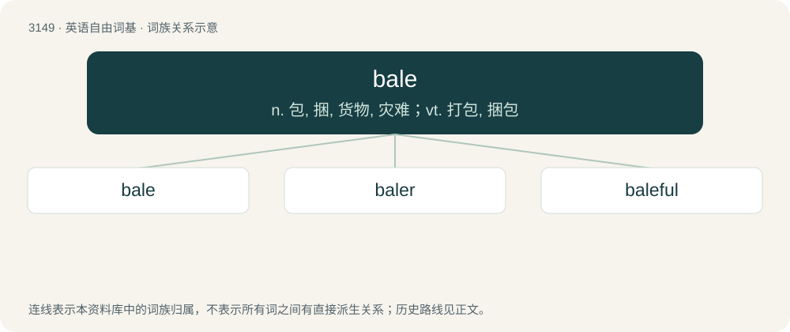

# 3252 · bale — n. 包, 捆, 货物, 灾难；vt. 打包, 捆包

[总目录](../00_总目录_按常用程度.md)

**类型**：英语自由词基　｜　**来源语言**：见词源记录

## 核心含义与来源

- 核心含义：n. 包, 捆, 货物, 灾难；vt. 打包, 捆包
- 英文含义：Evil, especially considered as an active force for destruction or death.
- 词形：bale

**多个词源／构词路径**：同一拼写可能有不同来源；以下按词性和含义分别列出。

**来源记录 1**（名词；Evil, especially considered as an active force for destruction or death.）

From Middle English bale (“evil”), from Old English bealu, from Proto-West Germanic \*balu, from Proto-Germanic \*balwą. Cognate with Low German bal- (“bad, ill”), Gothic 𐌱𐌰𐌻𐍅𐌴𐌹𐌽𐍃 (balweins, “torture”), Old High German balo (“destruction”), Old Norse bǫl (“disaster”).

**来源记录 2**（名词；A rounded bundle or package of goods in a cloth cover, and corded for storage or transportation.）

From Middle English bale (“bale”), from Old French bale and Medieval Latin bala, of Germanic origin. Doublet of ball.

**来源记录 3**（动词；To remove water from a boat with buckets etc.）

Alternative spelling of bail.

## 词族图

## 单词速览（常用到不常用）

| 单词 | 音标 | 释义 |
|---|---|---|
| [bale](#w-1) | /beɪl/ | n. 包, 捆, 货物, 灾难；vt. 打包, 捆包 |
| [baler](#w-2) | /ˈbeilə/ | \[化\] 打包机 |
| [baleful](#w-3) | /ˈbeɪl.fəl/ | a. 有害的, 恶意的 |

## 逐词详解

### 1. bale

**词性**：名词　｜　**音标**：/beɪl/

**中文释义**：n. 包, 捆, 货物, 灾难；vt. 打包, 捆包

**英文义项**：Evil, especially considered as an active force for destruction or death. / Suffering, woe, torment.

**词源与演化**：

From Middle English bale (“evil”), from Old English bealu, from Proto-West Germanic \*balu, from Proto-Germanic \*balwą. Cognate with Low German bal- (“bad, ill”), Gothic 𐌱𐌰𐌻𐍅𐌴𐌹𐌽𐍃 (balweins, “torture”), Old High German balo (“destruction”), Old Norse bǫl (“disaster”).

**例句**：

> Bale was fouled, and his team was awarded a free kick.

### 2. baler

**词性**：名词　｜　**音标**：/ˈbeilə/

**中文释义**：\[化\] 打包机

**英文义项**：A machine for creating bales, e.g., of hay or cotton. / A person who creates bales, either by operating or feeding such a machine, or by creating the bales by hand.

**构词拆分**：bale + -er

**词源与演化**：

From bale (verb) + -er.

**例句**：

> Farmer Jones is in straits because his baler is broken down and he's got three fields of hay ready to bale.

该用例对应义项：A machine for creating bales, e.g., of hay or cotton.

### 3. baleful

**词性**：形容词　｜　**音标**：/ˈbeɪl.fəl/

**中文释义**：a. 有害的, 恶意的

**英文义项**：Portending evil; ominous.

**构词拆分**：By surface analysis, bale (“evil, woe”) + -ful

**词源与演化**：

From Middle English baleful, balful, baluful, from Old English bealuful, which was equivalent to bealu + -ful. By surface analysis, bale (“evil, woe”) + -ful. See bale for further etymology.

**例句**：

> For them the baleful effects of climate change aren’t vague or theoretical but already happening before their eyes.
