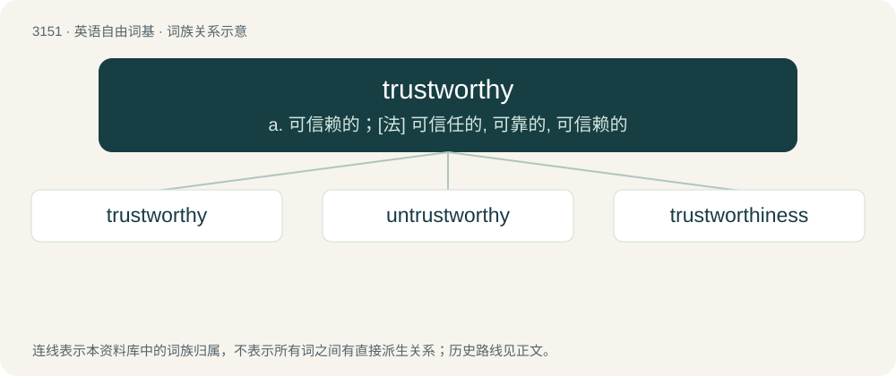

# 3254 · trustworthy — a. 可信赖的；\[法\] 可信任的, 可靠的, 可信赖的

[总目录](../00_总目录_按常用程度.md)

**类型**：英语自由词基　｜　**来源语言**：见词源记录

## 核心含义与来源

- 核心含义：a. 可信赖的；\[法\] 可信任的, 可靠的, 可信赖的
- 英文含义：Deserving of trust, reliable.
- 词形：trustworthy

**来源记录 1**（形容词；Deserving of trust, reliable.）

From trust + -worthy.

## 词族图

## 单词速览（常用到不常用）

| 单词 | 音标 | 释义 |
|---|---|---|
| [trustworthy](#w-1) | 英 /ˈtɹʌst.wɜː.ði/；美 /ˈtɹʌstˌwɜɹ.ði/ | a. 可信赖的；\[法\] 可信任的, 可靠的, 可信赖的 |
| [untrustworthy](#w-2) | 英 /ˌʌnˈtɹʌstˌwɜːði/；美 /ˌʌnˈtɹʌstˌwɜɹ.ði/ | a. 不能信赖的, 靠不住的 |
| [trustworthiness](#w-3) | /ˈtɹʌst.wɜɹ.ði.nɛs/ | n. 可信赖, 确实性 |

## 逐词详解

### 1. trustworthy

**词性**：形容词　｜　**音标**：英 /ˈtɹʌst.wɜː.ði/；美 /ˈtɹʌstˌwɜɹ.ði/

**中文释义**：a. 可信赖的；\[法\] 可信任的, 可靠的, 可信赖的

**英文义项**：Deserving of trust, reliable.

**构词拆分**：trust + -worthy

**词源与演化**：

From trust + -worthy.

**例句**：

> An experienced and trustworthy traveling companion.

该用例对应义项：worthy of trust or belief

### 2. untrustworthy

**词性**：形容词　｜　**音标**：英 /ˌʌnˈtɹʌstˌwɜːði/；美 /ˌʌnˈtɹʌstˌwɜɹ.ði/

**中文释义**：a. 不能信赖的, 靠不住的

**英文义项**：Not deserving of trust; unreliable.

**构词拆分**：un- + trustworthy

**词源与演化**：

From un- + trustworthy.

**例句**：

> He is one of the most untrustworthy people I have ever met.

### 3. trustworthiness

**词性**：名词　｜　**音标**：/ˈtɹʌst.wɜɹ.ði.nɛs/

**中文释义**：n. 可信赖, 确实性

**英文义项**：The state or quality of being trustworthy or reliable.

**构词拆分**：trustworthy + -ness

**词源与演化**：

From trustworthy + -ness.

**例句**：

> These five principles were loyalty, filial duty, trustworthiness, valor, and justice.
