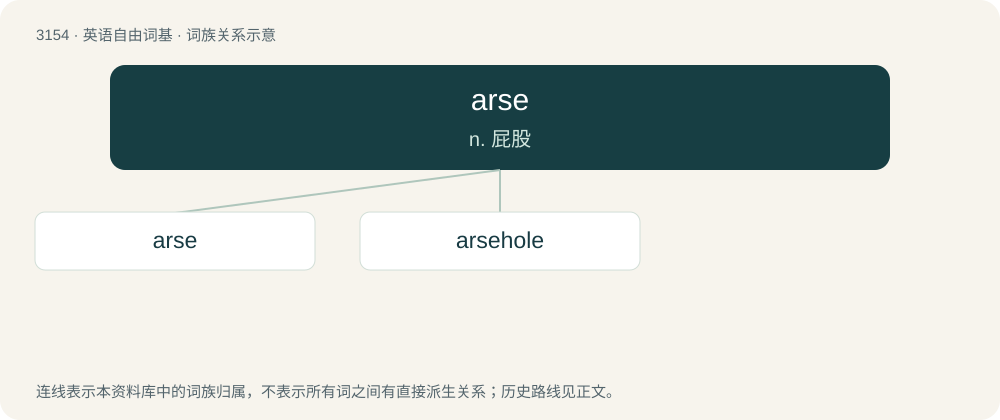

# 3258 · arse — n. 屁股

[总目录](../00_总目录_按常用程度.md)

**类型**：英语自由词基　｜　**来源语言**：见词源记录

## 核心含义与来源

- 核心含义：n. 屁股
- 英文含义：A person's buttocks; the bottom, the backside. Also: the anus; the rectum.
- 词形：arse

**来源记录 1**（名词；A person's buttocks; the bottom, the backside. Also: the anus; the rectum.）

From Middle English ars, ers, from Old English ærs, ears, from Proto-West Germanic \*ars, from Proto-Germanic \*arsaz (compare Dutch aars and German Arsch), from Proto-Indo-European \*h₁órsos (“backside, buttocks”).

## 词族图

## 单词速览（常用到不常用）

| 单词 | 音标 | 释义 |
|---|---|---|
| [arse](#w-1) | 英 /ɑːs/；美 /ɑɹs/ | n. 屁股 |
| [arsehole](#w-2) | /ˈɑː(ɹ)s.hoʊl/ | n. 屁眼儿, 肛门 |

## 逐词详解

### 1. arse

**词性**：动词　｜　**音标**：英 /ɑːs/；美 /ɑɹs/

**中文释义**：n. 屁股

**英文义项**：To be silly, act stupid or mess around.

**词源与演化**：

From Middle English ars, ers, from Old English ærs, ears, from Proto-West Germanic \*ars, from Proto-Germanic \*arsaz (compare Dutch aars and German Arsch), from Proto-Indo-European \*h₁órsos (“backside, buttocks”).

**例句**：

> He's always been a dour twat with a face like a cat's arse.

### 2. arsehole

**词性**：名词　｜　**音标**：/ˈɑː(ɹ)s.hoʊl/

**中文释义**：n. 屁眼儿, 肛门

**英文义项**：The anus. / An inconsiderate, mean-spirited, or otherwise contemptible person. (Less offensive than fucker or cunt.)

**构词拆分**：arse + hole

**词源与演化**：

From Middle English arce-hoole, equivalent to arse + hole. Compare Old English ears-þyrel (“anus”, literally “arse-hole”).

**例句**：

> The moment I sat on the toilet, my crap immediately came out of my arsehole.

该用例对应义项：The anus.
