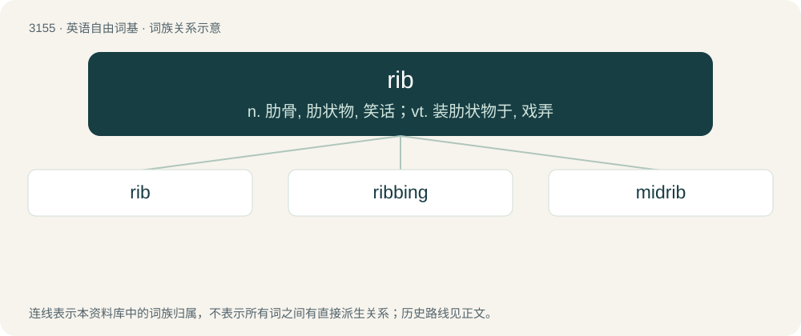

# 3259 · rib — n. 肋骨, 肋状物, 笑话；vt. 装肋状物于, 戏弄

[总目录](../00_总目录_按常用程度.md)

**类型**：英语自由词基　｜　**来源语言**：见词源记录

## 核心含义与来源

- 核心含义：n. 肋骨, 肋状物, 笑话；vt. 装肋状物于, 戏弄
- 英文含义：Any of a series of long curved bones occurring in 12 pairs in humans and other animals and extending from the spine to or toward the sternum.
- 词形：rib

**多个词源／构词路径**：同一拼写可能有不同来源；以下按词性和含义分别列出。

**来源记录 1**（名词；Any of a series of long curved bones occurring in 12 pairs in humans and other animals and extending from the spine to or toward the sternum.）

From Middle English rib, ribbe, from Old English ribb (“rib”), from Proto-West Germanic \*ribi, from Proto-Germanic \*ribją (“rib, reef”), from Proto-Indo-European \*h₁rebʰ- (“arch, ceiling, cover”). Cognate with Dutch rib (“rib”), Norwegian ribbe (“sparerib”), Norwegian ribben (“rib”), Low German ribbe (“rib”), German Rippe (“rib”), Old Norse rif (“rib, reef”), Serbo-Croatian rèbro (“rib”). (wife or woman): In reference to the creation of Eve from Adam's rib in the Bible.

**来源记录 2**（名词；Hound's-tongue (Cynoglossum officinale).）

From Middle English ribbe, from Old English ribbe (“hound's-tongue”).

## 词族图

## 单词速览（常用到不常用）

| 单词 | 音标 | 释义 |
|---|---|---|
| [rib](#w-1) | /ɹɪb/ | n. 肋骨, 肋状物, 笑话；vt. 装肋状物于, 戏弄 |
| [ribbing](#w-2) | /ˈɹɪbɪŋ/ | n. 肋状组织翅, 肋骨, 田垄, 玩笑 |
| [midrib](#w-3) | /ˈmɪdrɪb/ | n. 中脉；\[医\] 中脉(叶) |

## 逐词详解

### 1. rib

**词性**：名词　｜　**音标**：/ɹɪb/

**中文释义**：n. 肋骨, 肋状物, 笑话；vt. 装肋状物于, 戏弄

**英文义项**：Any of a series of long curved bones occurring in 12 pairs in humans and other animals and extending from the spine to or toward the sternum. / A part or piece, similar to a rib, and serving to shape or support something.

**词源与演化**：

From Middle English rib, ribbe, from Old English ribb (“rib”), from Proto-West Germanic \*ribi, from Proto-Germanic \*ribją (“rib, reef”), from Proto-Indo-European \*h₁rebʰ- (“arch, ceiling, cover”). Cognate with Dutch rib (“rib”), Norwegian ribbe (“sparerib”), Norwegian ribben (“rib”), Low German ribbe (“rib”), German Rippe (“rib”), Old Norse rif (“rib, reef”), Serbo-Croatian rèbro (“rib”). (wife or woman): In reference to the creation of Eve from Adam's rib in the Bible.

**用法示例／搭配（非完整句）**：

> a broken rib on the umbrella

该用例对应义项：A part or piece, similar to a rib, and serving to shape or support something.

### 2. ribbing

**词性**：形容词　｜　**音标**：/ˈɹɪbɪŋ/

**中文释义**：n. 肋状组织翅, 肋骨, 田垄, 玩笑

**英文义项**：jesting; joking

**构词拆分**：rib (“tease”, verb) + -ing

**词源与演化**：

From rib (“tease”, verb) + -ing; from the common practice of tickling the ribs to cause laughter.

**例句**：

> Tom copped a fair bit of ribbing about his battered old car.

### 3. midrib

**词性**：名词　｜　**音标**：/ˈmɪdrɪb/

**中文释义**：n. 中脉；\[医\] 中脉(叶)

**英文义项**：The strengthened vein down the middle of a flower petal or simple leaf or leaflet. / The continuation of the petiole of a pinnately compound leaf around which the leaflets attach.

**构词拆分**：mid- + rib

**词源与演化**：

From mid- + rib.
