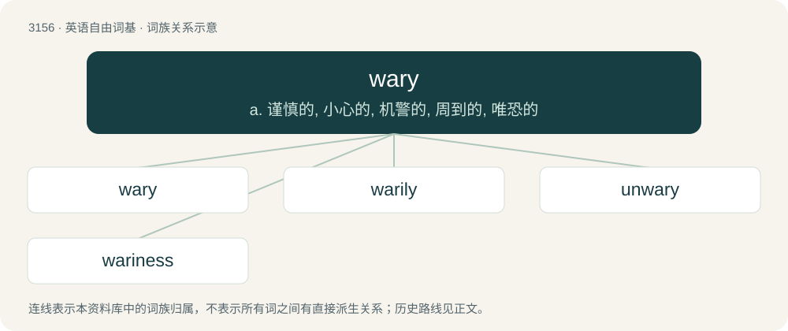

# 3261 · wary — a. 谨慎的, 小心的, 机警的, 周到的, 唯恐的

[总目录](../00_总目录_按常用程度.md)

**类型**：英语自由词基　｜　**来源语言**：见词源记录

## 核心含义与来源

- 核心含义：a. 谨慎的, 小心的, 机警的, 周到的, 唯恐的
- 英文含义：Cautious of danger; carefully watching and guarding against deception, trickery, and dangers; suspiciously prudent
- 词形：wary

**多个词源／构词路径**：同一拼写可能有不同来源；以下按词性和含义分别列出。

**来源记录 1**（形容词；Cautious of danger; carefully watching and guarding against deception, trickery, and dangers; suspiciously prudent）

From the adjective ware + -y.

**来源记录 2**（动词；To curse, revile.）

From Middle English warien, from Old English wierġan (“to curse, do evil”), from Proto-West Germanic \*wargijan, from Proto-Germanic \*wargijaną (“to condemn, curse”), from Proto-Germanic \*wargaz (“criminal”). Doublet of warry.

## 词族图

## 单词速览（常用到不常用）

| 单词 | 音标 | 释义 |
|---|---|---|
| [wary](#w-1) | 英 /ˈwɛə.ɹi/；美 /ˈwɛɚ.i/ | a. 谨慎的, 小心的, 机警的, 周到的, 唯恐的 |
| [warily](#w-2) | /ˈwєərili/ | adv. 谨慎地, 留心地, 小心地 |
| [unwary](#w-3) | /.ʌnˈwєəri/ | a. 不谨慎的, 不注意的, 粗心的, 易上当的 |
| [wariness](#w-4) | /ˈwєərinis/ | n. 谨慎, 注意, 小心 |

## 逐词详解

### 1. wary

**词性**：形容词　｜　**音标**：英 /ˈwɛə.ɹi/；美 /ˈwɛɚ.i/

**中文释义**：a. 谨慎的, 小心的, 机警的, 周到的, 唯恐的

**英文义项**：Cautious of danger; carefully watching and guarding against deception, trickery, and dangers; suspiciously prudent / Characterized by caution; guarded; careful; on one's guard

**构词拆分**：ware + -y

**词源与演化**：

From the adjective ware + -y.

**例句**：

> He is wary of dogs.

该用例对应义项：Cautious of danger; carefully watching and guarding against deception, trickery, and dangers; suspiciously prudent

### 2. warily

**词性**：副词　｜　**音标**：/ˈwєərili/

**中文释义**：adv. 谨慎地, 留心地, 小心地

**英文义项**：In a careful and guarded manner, especially to avoid potential danger or harm. / Without trust; in a manner showing a lack of trust.

**构词拆分**：wary + -ly

**词源与演化**：

From wary + -ly.

**例句**：

> She walked through the dark alley, warily glancing around to make sure she wasn't being followed.

该用例对应义项：In a careful and guarded manner, especially to avoid potential danger or harm.

### 3. unwary

**词性**：形容词　｜　**音标**：/.ʌnˈwєəri/

**中文释义**：a. 不谨慎的, 不注意的, 粗心的, 易上当的

**英文义项**：Lacking caution as a result of naïveté or inexperience. / Unprepared; not watchful.

**构词拆分**：un- + wary

**词源与演化**：

From un- + wary. Compare Old English unwær (“unaware, unwary”) and unwærlīċ (“unwary, heedless”).

**例句**：

> The shrieks of unwary animals taken by surprise.

该用例对应义项：not alert to danger or deception

### 4. wariness

**词性**：名词　｜　**音标**：/ˈwєərinis/

**中文释义**：n. 谨慎, 注意, 小心

**英文义项**：vigilance or the condition of being alert / precautionary forethought to avoid harm or risk

**构词拆分**：wary + -ness

**词源与演化**：

From wary + -ness.
