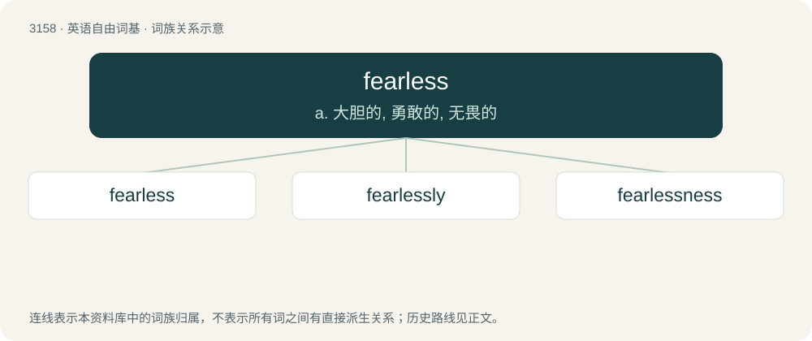

# 3262 · fearless — a. 大胆的, 勇敢的, 无畏的

[总目录](../00_总目录_按常用程度.md)

**类型**：英语自由词基　｜　**来源语言**：见词源记录

## 核心含义与来源

- 核心含义：a. 大胆的, 勇敢的, 无畏的
- 英文含义：Without fear.
- 词形：fearless

**来源记录 1**（形容词；Without fear.）

From fear + -less.

## 词族图

## 单词速览（常用到不常用）

| 单词 | 音标 | 释义 |
|---|---|---|
| [fearless](#w-1) | 英 /ˈfɪələs/；美 /ˈfɪɹləs/ | a. 大胆的, 勇敢的, 无畏的 |
| [fearlessly](#w-2) | /ˈfɪələslɪ/ | adv. 无畏地, 大胆地 |
| [fearlessness](#w-3) | 美 /ˈfɪəlɪsnɪs/ | n. 无畏, 勇敢 |

## 逐词详解

### 1. fearless

**词性**：形容词　｜　**音标**：英 /ˈfɪələs/；美 /ˈfɪɹləs/

**中文释义**：a. 大胆的, 勇敢的, 无畏的

**英文义项**：Without fear.

**构词拆分**：fear + -less

**词源与演化**：

From fear + -less.

**例句**：

> Fearless reporters and photographers.

该用例对应义项：invulnerable to fear or intimidation

### 2. fearlessly

**词性**：副词　｜　**音标**：/ˈfɪələslɪ/

**中文释义**：adv. 无畏地, 大胆地

**英文义项**：In a fearless manner; without fear.

**构词拆分**：fearless + -ly

**词源与演化**：

From fearless + -ly.

**例句**：

> Fearlessly, he led the troops into combat.

该用例对应义项：without fear

### 3. fearlessness

**词性**：名词　｜　**音标**：美 /ˈfɪəlɪsnɪs/

**中文释义**：n. 无畏, 勇敢

**英文义项**：The quality of being fearless.

**构词拆分**：fearless + -ness

**词源与演化**：

From fearless + -ness.

**例句**：

> There is nothing to fear but fearlessness.
