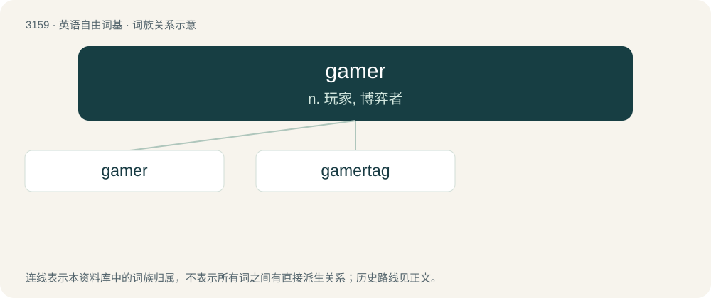

# 3263 · gamer — n. 玩家, 博弈者

[总目录](../00_总目录_按常用程度.md)

**类型**：英语自由词基　｜　**来源语言**：见词源记录

## 核心含义与来源

- 核心含义：n. 玩家, 博弈者
- 英文含义：A person who plays any kind of game.
- 词形：gamer

**来源记录 1**（名词；A person who plays any kind of game.）

From Middle English gamer, attested since before 1450 as a common noun and possibly since 1248 in the name of one Johannes le Gamer. Equivalent to game (noun) + -er (occupational suffix).

## 词族图

## 单词速览（常用到不常用）

| 单词 | 音标 | 释义 |
|---|---|---|
| [gamer](#w-1) | 英 /ˈɡeɪ̯mə/；美 /ˈɡeɪ̯mɚ/ | n. 玩家, 博弈者 |
| [gamertag](#w-2) |  | 【英文】A pseudonym by which an individual playing an online game with others is identified |

## 逐词详解

### 1. gamer

**词性**：名词　｜　**音标**：英 /ˈɡeɪ̯mə/；美 /ˈɡeɪ̯mɚ/

**中文释义**：n. 玩家, 博弈者

**英文义项**：A person who plays any kind of game. / A person whose hobby is video games.

**构词拆分**：game (noun) + -er (occupational suffix)

**词源与演化**：

From Middle English gamer, attested since before 1450 as a common noun and possibly since 1248 in the name of one Johannes le Gamer. Equivalent to game (noun) + -er (occupational suffix).

**例句**：

> At home, Tom juggles two roles: dad by day, gamer by night.

### 2. gamertag

**词性**：名词

**英文义项**：A pseudonym by which an individual playing an online game with others is identified

**构词拆分**：gamer + tag

**词源与演化**：

From gamer + tag.
