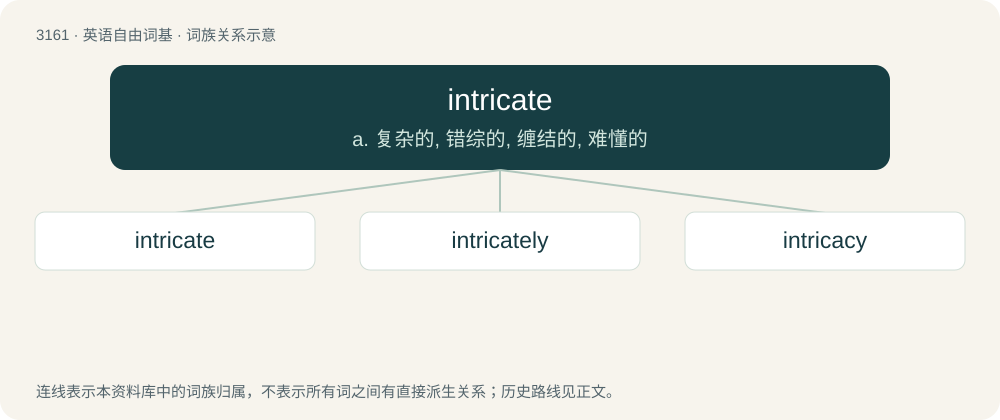

# 3265 · intricate — a. 复杂的, 错综的, 缠结的, 难懂的

[总目录](../00_总目录_按常用程度.md)

**类型**：英语自由词基　｜　**来源语言**：见词源记录

## 核心含义与来源

- 核心含义：a. 复杂的, 错综的, 缠结的, 难懂的
- 英文含义：Having a great deal of fine detail or complexity.
- 词形：intricate

**多个词源／构词路径**：同一拼写可能有不同来源；以下按词性和含义分别列出。

**来源记录 1**（形容词；Having a great deal of fine detail or complexity.）

From Middle English intricat(e) (“entangled, intricate”), from Latin intrīcātus, perfect passive participle of intricō, see -ate (adjective-forming suffix).

**来源记录 2**（动词；To become enmeshed or entangled.）

As for Etymology 1; from Latin intrīcātus, see -ate (verb-forming suffix).

## 词族图

## 单词速览（常用到不常用）

| 单词 | 音标 | 释义 |
|---|---|---|
| [intricate](#w-1) | /ˈɪn.tɹɪ.kət/ | a. 复杂的, 错综的, 缠结的, 难懂的 |
| [intricately](#w-2) | /ˈɪntrɪkətlɪ/ | adv. 杂乱地, 复杂地; 难懂地 |
| [intricacy](#w-3) | /ˈɪn.tɹɪ.kə.si/ | n. 纷乱, 复杂, 错综 |

## 逐词详解

### 1. intricate

**词性**：形容词　｜　**音标**：/ˈɪn.tɹɪ.kət/

**中文释义**：a. 复杂的, 错综的, 缠结的, 难懂的

**英文义项**：Having a great deal of fine detail or complexity.

**词源与演化**：

From Middle English intricat(e) (“entangled, intricate”), from Latin intrīcātus, perfect passive participle of intricō, see -ate (adjective-forming suffix).

**例句**：

> The architecture of this clock is very intricate.

该用例对应义项：Having a great deal of fine detail or complexity.

### 2. intricately

**词性**：副词　｜　**音标**：/ˈɪntrɪkətlɪ/

**中文释义**：adv. 杂乱地, 复杂地; 难懂地

**英文义项**：In an intricate manner; with involution or infoldings; with perplexity or intricacy.

**构词拆分**：intricate + -ly

**词源与演化**：

From intricate + -ly.

**例句**：

> The hilt of Sir Thomas' sword was intricately decorated with silver leaf.

### 3. intricacy

**词性**：名词　｜　**音标**：/ˈɪn.tɹɪ.kə.si/

**中文释义**：n. 纷乱, 复杂, 错综

**英文义项**：The state or quality of being intricate or entangled. / Perplexity.

**构词拆分**：From intric(ate) + -acy.

**词源与演化**：

From intric(ate) + -acy.

**用法示例／搭配（非完整句）**：

> the intricacy of a cause in controversy

该用例对应义项：The state or quality of being intricate or entangled.
