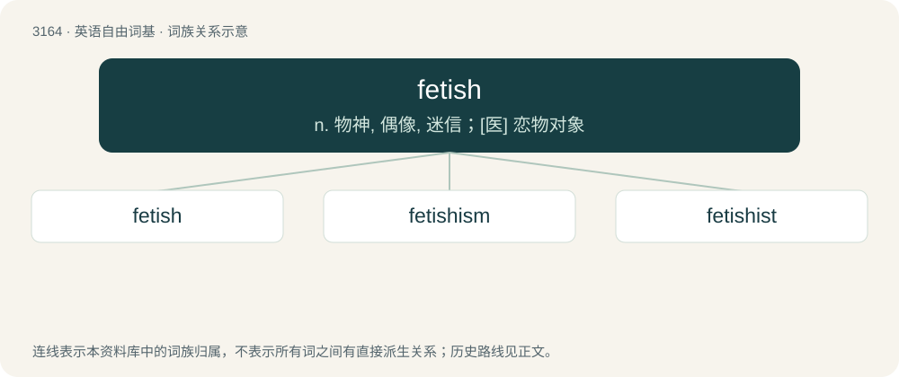

# 3267 · fetish — n. 物神, 偶像, 迷信；\[医\] 恋物对象

[总目录](../00_总目录_按常用程度.md)

**类型**：英语自由词基　｜　**来源语言**：见词源记录

## 核心含义与来源

- 核心含义：n. 物神, 偶像, 迷信；\[医\] 恋物对象
- 英文含义：Something which is believed to possess, contain, or cause spiritual or magical powers; an amulet or a talisman.
- 词形：fetish

**来源记录 1**（名词；Something which is believed to possess, contain, or cause spiritual or magical powers; an amulet or a talisman.）

Borrowed from French fétiche, from Portuguese feitiço, from Latin factīcius (“artificial”). Doublet of factitious.

## 词族图

## 单词速览（常用到不常用）

| 单词 | 音标 | 释义 |
|---|---|---|
| [fetish](#w-1) | 英 /ˈfɛt.ɪʃ/ | n. 物神, 偶像, 迷信；\[医\] 恋物对象 |
| [fetishism](#w-2) | /ˈfiːtiʃizm/ | n. 拜物教, 盲目崇拜, 拜物主义；\[医\] 恋物癖 |
| [fetishist](#w-3) | /ˈfɛtɪʃɪst/ | n. 物神崇拜者；\[医\] 恋物癖者 |

## 逐词详解

### 1. fetish

**词性**：名词　｜　**音标**：英 /ˈfɛt.ɪʃ/

**中文释义**：n. 物神, 偶像, 迷信；\[医\] 恋物对象

**英文义项**：Something which is believed to possess, contain, or cause spiritual or magical powers; an amulet or a talisman. / A figure representing the spirit of a deity, human, or animal; an idol or voodoo doll.

**词源与演化**：

Borrowed from French fétiche, from Portuguese feitiço, from Latin factīcius (“artificial”). Doublet of factitious.

**例句**：

> I know a guy who has a foot fetish.

该用例对应义项：Sexual fixation to or arousal at something abnormally sexual or non-sexual, such as an object or a non-sexual part of the body.

### 2. fetishism

**词性**：名词　｜　**音标**：/ˈfiːtiʃizm/

**中文释义**：n. 拜物教, 盲目崇拜, 拜物主义；\[医\] 恋物癖

**英文义项**：The belief that natural objects have supernatural powers, or that something created by people has power over people. / A form of paraphilia where the object of attraction is an inanimate object or a part of a person's body.

**构词拆分**：fetish + -ism

**词源与演化**：

From fetish + -ism.

### 3. fetishist

**词性**：名词　｜　**音标**：/ˈfɛtɪʃɪst/

**中文释义**：n. 物神崇拜者；\[医\] 恋物癖者

**英文义项**：One who has a sexual fetish.

**构词拆分**：fetish + -ist

**词源与演化**：

From fetish + -ist.
