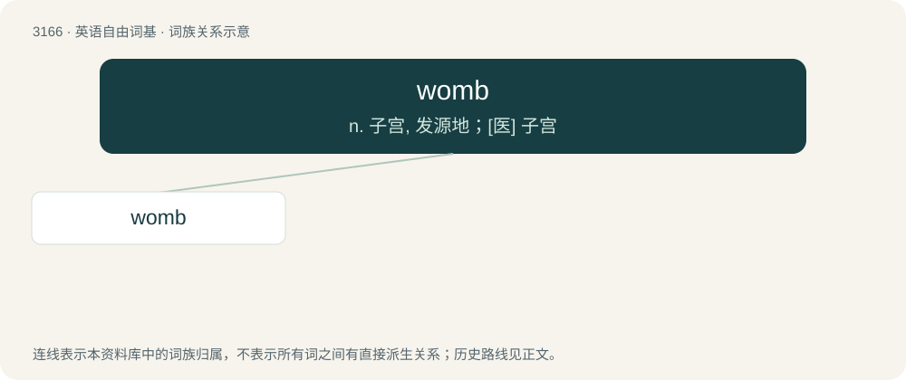

# 3268 · womb — n. 子宫, 发源地；\[医\] 子宫

[总目录](../00_总目录_按常用程度.md)

**类型**：英语自由词基　｜　**来源语言**：见词源记录

## 核心含义与来源

- 核心含义：n. 子宫, 发源地；\[医\] 子宫
- 英文含义：In female mammals, the organ in which the young are conceived and grow until birth; the uterus.
- 词形：womb

**来源记录 1**（名词；In female mammals, the organ in which the young are conceived and grow until birth; the uterus.）

From Middle English wombe, wambe, from Old English womb, wamb (“belly, stomach; bowels; heart; womb; hollow”), from Proto-West Germanic \*wambu, from Proto-Germanic \*wambō (“belly, stomach, abdomen”). Cognate with Scots wam, wame (“womb”), Dutch wam (“dewlap of beef; belly of a fish”), German Wamme, Wampe (“paunch, belly”), Danish vom (“belly, paunch, rumen”), Swedish våmb (“belly, stomach, rumen”), Norwegian vom (“rumen”), Icelandic vömb (“belly, abdomen, stomach”), Old Welsh gumbelauc (“womb”), Breton gwamm (“woman, wife”), Sanskrit वपा (vapā́, “the skin or membrane lining the intestines or parts of the viscera, the caul or omentum”). Superseded nonnative Middle English mater, matere (“womb”), and matris, matrice (“womb”) borrowed from Latin māter (“womb”) and Old French matrice (“womb”), respectively.

## 词族图

## 单词速览（常用到不常用）

| 单词 | 音标 | 释义 |
|---|---|---|
| [womb](#w-1) | /wuːm/ | n. 子宫, 发源地；\[医\] 子宫 |

## 逐词详解

### 1. womb

**词性**：名词　｜　**音标**：/wuːm/

**中文释义**：n. 子宫, 发源地；\[医\] 子宫

**英文义项**：In female mammals, the organ in which the young are conceived and grow until birth; the uterus. / A place where something is made or formed.

**词源与演化**：

From Middle English wombe, wambe, from Old English womb, wamb (“belly, stomach; bowels; heart; womb; hollow”), from Proto-West Germanic \*wambu, from Proto-Germanic \*wambō (“belly, stomach, abdomen”). Cognate with Scots wam, wame (“womb”), Dutch wam (“dewlap of beef; belly of a fish”), German Wamme, Wampe (“paunch, belly”), Danish vom (“belly, paunch, rumen”), Swedish våmb (“belly, stomach, rumen”), Norwegian vom (“rumen”), Icelandic vömb (“belly, abdomen, stomach”), Old Welsh gumbelauc (“womb”), Breton gwamm (“woman, wife”), Sanskrit वपा (vapā́, “the skin or membrane lining the intestines or parts of the viscera, the caul or omentum”). Superseded nonnative Middle English mater, matere (“womb”), and matris, matrice (“womb”) borrowed from Latin māter (“womb”) and Old French matrice (“womb”), respectively.

**例句**：

> The national health service takes care of you from womb to tomb.
