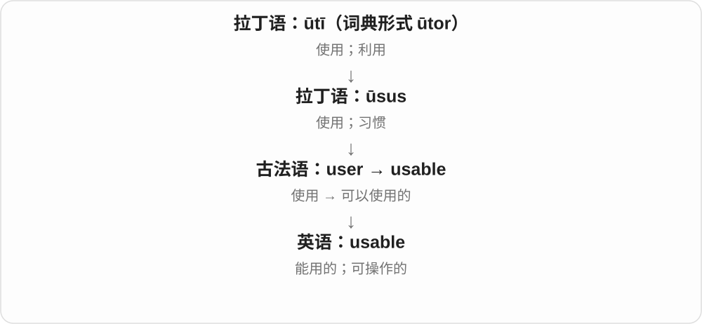
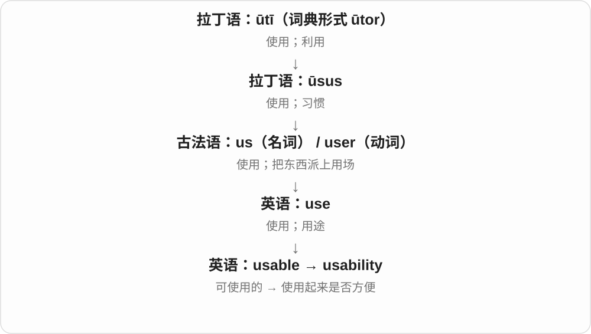

# 3269 · usable — 能否用起来，与使用起来是否顺手

[逐词精讲目录](../00_逐词精讲目录.md) · [总目录](../00_总目录_按常用程度.md)

## 核心词根与来源

usable 先过能用这一关，usability 再谈使用的方便程度。不能用与还没用，是两个问题。

**USABLE：拿到手，能不能真正用上**

usable → usability；unusable 否定可用性。

- **可用、好用与不能用**：usable · usability · unusable

## 词形与演化规律

use + -able 去末尾 e → usable；usable + -ity 对应 usability，-able 改为 -ability；un- 否定。

## 单词速览（按词族由简到繁）

同一基础词的相关扩展放在一起，先读基础形式，再读扩展；各组之间优先读常用的。具体词源关系见各词讲解。

| 单词 | 音标 | 核心意思 |
|---|---|---|
| [usable](#w-1) | /ˈjuːzəbəl/ | 能用的；可使用的 |
| [usability](#w-2) | /ˌjuːzəˈbɪləti/ | 易用性；可用性 |
| [unusable](#w-3) | /ʌnˈjuːzəbəl/ | 不能使用的；不适用的 |

## 逐词讲解

### 1. usable — 能用的；可使用的

**音标**：/ˈjuːzəbəl/

**先抓住这个画面**

usable 是过了“能不能拿来用”这一关：旧椅子虽然不好看，但只要能安全坐，就仍然 usable。

**怎么拆**

来自古法语 usable，基础是 user“使用”。现代英语里也容易看成 use + -able“可以被使用的”。

**怎么变成今天的意思**

它不保证东西最漂亮、最省力或最适合你，只说明还有实际使用的可能。软件语境里也常包含“操作起来能用得顺”的要求。

**常见搭配与例句**

still usable；a usable version；make something usable；usable space。

> The screen is cracked, but the phone is still usable.

屏幕裂了，不过手机还能用。

> We need a usable draft by Friday, even if it is not perfect.

我们周五前需要一份能用的草稿，即使它还不完美。

**别混淆**

usable 说能不能用；useful 说有没有帮助。一个功能能点开，不等于它值得使用。

### 2. usability — 易用性；可用性

**音标**：/ˌjuːzəˈbɪləti/

**先抓住这个画面**

usability 看的是“人用起来顺不顺”：按钮找不找得到，步骤好不好懂，犯错后能不能补救。

**怎么拆**

usable + -ity；-able 在这类性质名词中对应 -ability。不是“使用的超能力”。

**怎么变成今天的意思**

一般意义上是可使用的程度；在产品设计里，重点常落到用户完成任务是否有效、顺手。东西有很多功能，usability 仍然可能很差。

**常见搭配与例句**

usability testing；improve usability；a usability problem；website usability。

> The team tested the usability of the booking form.

团队测试了预约表单是否容易使用。

> Clearer labels greatly improved the app’s usability.

更清楚的标签大大改善了这个应用的易用性。

**别混淆**

usability 问好不好用；utility 问能不能满足某种需要。没有你需要的功能，再容易操作也解决不了你的问题。

### 3. unusable — 不能使用的；不适用的

**音标**：/ʌnˈjuːzəbəl/

**先抓住这个画面**

文件打不开、椅子断了腿、数据乱到无法利用，都可能是 unusable：拿到了也没法按需要用起来。

**怎么拆**

un- 否定 + usable 可使用的；usable 对应 use 去末尾 e 加 -able。un- 否定整个性质，不是动作“把使用撤销”。

**怎么变成今天的意思**

**英语 use + -able → usable**  
可以使用、适于使用的

↓

**un- + usable → unusable**  
不能用；不适合使用

an unusable file 无法使用的文件；an unusable room 无法正常使用的房间；render something unusable 使某物无法使用。

**常见搭配与例句**

an unusable file；render something unusable。

> The damaged file was unusable.

损坏的文件无法使用了。

> Heavy rain left the outdoor stage unusable.

大雨使室外舞台无法使用。

**别混淆**

unusable 不能用，unused 没被用；全新的备用文件可能 unused，却完全 usable。

## 这一组要分清什么

usable 不保证使用体验出色；unusable 不是 unused；usability 也不是系统运行时间指标 availability 的通用替代。

## 串起来练习

The old file is usable, but the interface has poor usability.

旧文件还能用，但界面使用起来不方便。
