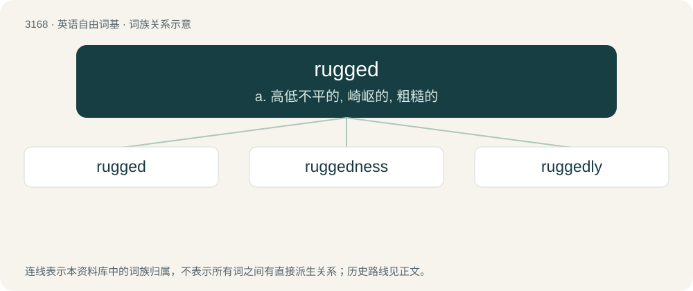

# 3271 · rugged — a. 高低不平的, 崎岖的, 粗糙的

[总目录](../00_总目录_按常用程度.md)

**类型**：英语自由词基　｜　**来源语言**：见词源记录

## 核心含义与来源

- 核心含义：a. 高低不平的, 崎岖的, 粗糙的
- 英文含义：Broken into sharp or irregular points; uneven; not smooth; rough.
- 词形：rugged

**多个词源／构词路径**：同一拼写可能有不同来源；以下按词性和含义分别列出。

**来源记录 1**（形容词；Broken into sharp or irregular points; uneven; not smooth; rough.）

From Middle English rugged, roggyd, ruggyd, derived from Old Norse rǫgg (“tuft, shagginess”), equivalent to rug (“rough, woollen material”) + -ed. Compare Old Swedish ruggoter (“wrinkled”), Swedish rugga (“to roughen”), Swedish ruggig (“shaggy”), Icelandic rögg (“shagginess”), Old Norse raggaðr (“tufted”), dialectal Danish raggad (“shaggy”).

**来源记录 2**（形容词；Having a rug or rugs.）

From rug + -ed.

## 词族图

## 单词速览（常用到不常用）

| 单词 | 音标 | 释义 |
|---|---|---|
| [rugged](#w-1) | /ˈɹʌɡ.ɪd/ | a. 高低不平的, 崎岖的, 粗糙的 |
| [ruggedness](#w-2) | /ˈrʌ^idnis/ | n. 险峻, 粗野 |
| [ruggedly](#w-3) | /ˈrʌɡɪdlɪ/ | adv. 险峻地; 粗暴地; （面容）多皱纹地; 粗线条地 |

## 逐词详解

### 1. rugged

**词性**：形容词　｜　**音标**：/ˈɹʌɡ.ɪd/

**中文释义**：a. 高低不平的, 崎岖的, 粗糙的

**英文义项**：Broken into sharp or irregular points; uneven; not smooth; rough. / Not neat or regular; irregular, uneven.

**构词拆分**：rug (“rough, woollen material”) + -ed

**词源与演化**：

From Middle English rugged, roggyd, ruggyd, derived from Old Norse rǫgg (“tuft, shagginess”), equivalent to rug (“rough, woollen material”) + -ed. Compare Old Swedish ruggoter (“wrinkled”), Swedish rugga (“to roughen”), Swedish ruggig (“shaggy”), Icelandic rögg (“shagginess”), Old Norse raggaðr (“tufted”), dialectal Danish raggad (“shaggy”).

**例句**：

> The area of Kherrata, in Algeria, is known for its rugged terrain.

### 2. ruggedness

**词性**：名词　｜　**音标**：/ˈrʌ^idnis/

**中文释义**：n. 险峻, 粗野

**英文义项**：The state of being rugged, or degree to which something is rugged. / A rugged or irregular feature.

**构词拆分**：rugged + -ness

**词源与演化**：

From rugged + -ness.

**例句**：

> The ruggedness of his exams caused half the class to fail.

该用例对应义项：the quality of being difficult to do

### 3. ruggedly

**词性**：副词　｜　**音标**：/ˈrʌɡɪdlɪ/

**中文释义**：adv. 险峻地; 粗暴地; （面容）多皱纹地; 粗线条地

**英文义项**：In a rugged manner.

**构词拆分**：rugged + -ly

**词源与演化**：

From Middle English ruggedli, ruggidly, equivalent to rugged + -ly.
