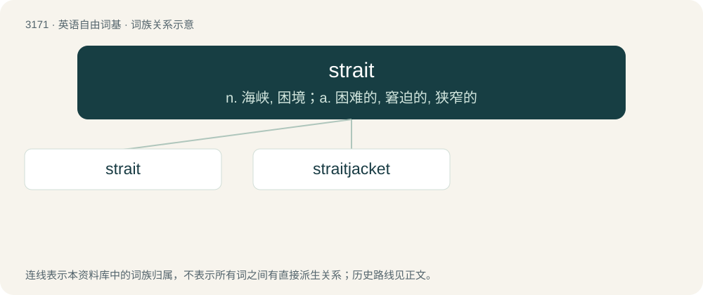

# 3272 · strait — n. 海峡, 困境；a. 困难的, 窘迫的, 狭窄的

[总目录](../00_总目录_按常用程度.md)

**类型**：英语自由词基　｜　**来源语言**：见词源记录

## 核心含义与来源

- 核心含义：n. 海峡, 困境；a. 困难的, 窘迫的, 狭窄的
- 英文含义：A narrow channel of water connecting two larger bodies of water.
- 词形：strait

**来源记录 1**（名词；A narrow channel of water connecting two larger bodies of water.）

From Middle English streit, from Old French estreit (modern form étroit), from Latin strictus, perfect passive participle of stringō (“compress, tighten”). Doublet of stretto and strict.

## 词族图

## 单词速览（常用到不常用）

| 单词 | 音标 | 释义 |
|---|---|---|
| [strait](#w-1) | /stɹeɪt/ | n. 海峡, 困境；a. 困难的, 窘迫的, 狭窄的 |
| [straitjacket](#w-2) | /ˈstɹeɪtˌd͡ʒækɪt/ | n. 紧身衣 |

## 逐词详解

### 1. strait

**词性**：名词　｜　**音标**：/stɹeɪt/

**中文释义**：n. 海峡, 困境；a. 困难的, 窘迫的, 狭窄的

**英文义项**：A narrow channel of water connecting two larger bodies of water. / A narrow pass, passage or street.

**词源与演化**：

From Middle English streit, from Old French estreit (modern form étroit), from Latin strictus, perfect passive participle of stringō (“compress, tighten”). Doublet of stretto and strict.

**用法示例／搭配（非完整句）**：

> the Strait of Gibraltar

该用例对应义项：A narrow channel of water connecting two larger bodies of water.

### 2. straitjacket

**词性**：名词　｜　**音标**：/ˈstɹeɪtˌd͡ʒækɪt/

**中文释义**：n. 紧身衣

**英文义项**：A jacketlike garment with very long sleeves which can be secured in place, thus preventing the wearer from moving their arms; often used in psychiatric hospitals to prevent patients from injuring themselves or others. / Any situation seen as confining or restricting.

**构词拆分**：strait + jacket

**词源与演化**：

From strait (“restrictive”) + jacket.

**用法示例／搭配（非完整句）**：

> our ever-increasing bureaucratic straitjacket of regulations

该用例对应义项：Any situation seen as confining or restricting.
