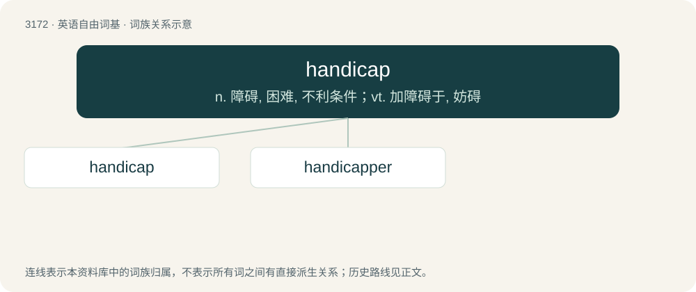

# 3273 · handicap — n. 障碍, 困难, 不利条件；vt. 加障碍于, 妨碍

[总目录](../00_总目录_按常用程度.md)

**类型**：英语自由词基　｜　**来源语言**：见词源记录

## 核心含义与来源

- 核心含义：n. 障碍, 困难, 不利条件；vt. 加障碍于, 妨碍
- 英文含义：Something that prevents, hampers, or hinders.
- 词形：handicap

**来源记录 1**（名词；Something that prevents, hampers, or hinders.）

From hand-in-cap, in reference to holding the game stakes in a cap.

## 词族图

## 单词速览（常用到不常用）

| 单词 | 音标 | 释义 |
|---|---|---|
| [handicap](#w-1) | /ˈhændikæp/ | n. 障碍, 困难, 不利条件；vt. 加障碍于, 妨碍 |
| [handicapper](#w-2) | /ˈhændi,kæpə(r)/ | n. 主管 handicap 的裁判人员 |

## 逐词详解

### 1. handicap

**词性**：名词　｜　**音标**：/ˈhændikæp/

**中文释义**：n. 障碍, 困难, 不利条件；vt. 加障碍于, 妨碍

**英文义项**：Something that prevents, hampers, or hinders. / An allowance of a certain amount of time or distance in starting, granted in a race (or other contest of skill) to the competitor possessing disadvantages; or an additional weight or other hindrance imposed upon the one possessing advantages, in order to equalize, as much as possible, the chances of success.

**词源与演化**：

From hand-in-cap, in reference to holding the game stakes in a cap.

**例句**：

> The older boy won, even though his opponent had been granted a handicap of five meters.

该用例对应义项：An allowance of a certain amount of time or distance in starting, granted in a race (or other contest of skill) to the competitor possessing disadvantages; or an additional weight or other hindrance imposed upon the one possessing advantages, in order to equalize, as much as possible, the chances of success.

### 2. handicapper

**词性**：名词　｜　**音标**：/ˈhændi,kæpə(r)/

**中文释义**：n. 主管 handicap 的裁判人员

**英文义项**：One who determines the conditions of a handicap. / A disabled person.

**构词拆分**：From handicap + -er.

**词源与演化**：

From handicap + -er.
