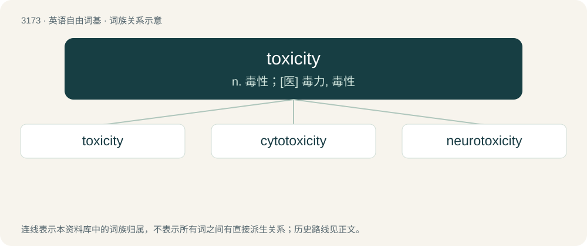

# 3274 · toxicity — n. 毒性；\[医\] 毒力, 毒性

[总目录](../00_总目录_按常用程度.md)

**类型**：英语自由词基　｜　**来源语言**：见词源记录

## 核心含义与来源

- 核心含义：n. 毒性；\[医\] 毒力, 毒性
- 英文含义：The quality or degree of being toxic.
- 词形：toxicity

**来源记录 1**（名词；The quality or degree of being toxic.）

From toxic + -ity.

## 词族图

## 单词速览（常用到不常用）

| 单词 | 音标 | 释义 |
|---|---|---|
| [toxicity](#w-1) | 英 /tɒkˈsɪs.ə.ti/；美 /tɑkˈsɪs.ə.ti/ | n. 毒性；\[医\] 毒力, 毒性 |
| [cytotoxicity](#w-2) | /,saitəutɔkˈsisiti/ | n. 细胞毒性 |
| [neurotoxicity](#w-3) | /,njuərəutɔkˈsisəti/ | n. \[农药\] 神经中毒性, 神经毒性 |

## 逐词详解

### 1. toxicity

**词性**：名词　｜　**音标**：英 /tɒkˈsɪs.ə.ti/；美 /tɑkˈsɪs.ə.ti/

**中文释义**：n. 毒性；\[医\] 毒力, 毒性

**英文义项**：The quality or degree of being toxic.

**构词拆分**：toxic + -ity

**词源与演化**：

From toxic + -ity.

**例句**：

> Researchers tested the toxicity of the chemical compound.

该用例对应义项：The quality or degree of being toxic.

### 2. cytotoxicity

**词性**：名词　｜　**音标**：/,saitəutɔkˈsisiti/

**中文释义**：n. 细胞毒性

**英文义项**：The property of being toxic to a cell.

**构词拆分**：cyto- + toxicity

**词源与演化**：

From cyto- + toxicity.

### 3. neurotoxicity

**词性**：名词　｜　**音标**：/,njuərəutɔkˈsisəti/

**中文释义**：n. \[农药\] 神经中毒性, 神经毒性

**英文义项**：The state or property of being neurotoxic.

**构词拆分**：neuro- + toxicity

**词源与演化**：

From neuro- + toxicity.
