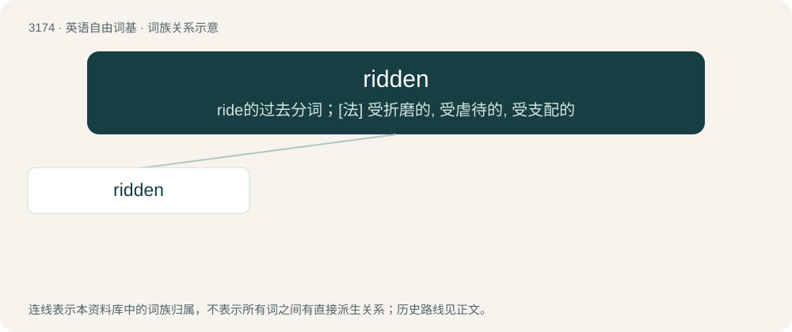

# 3275 · ridden — ride的过去分词；\[法\] 受折磨的, 受虐待的, 受支配的

[总目录](../00_总目录_按常用程度.md)

**类型**：英语自由词基　｜　**来源语言**：见词源记录

## 核心含义与来源

- 核心含义：ride的过去分词；\[法\] 受折磨的, 受虐待的, 受支配的
- 英文含义：Full of.
- 词形：ridden

**来源记录 1**（形容词；Full of.）

Morphologically ride + -en. See ride (verb).

## 词族图

## 单词速览（常用到不常用）

| 单词 | 音标 | 释义 |
|---|---|---|
| [ridden](#w-1) | /ˈɹɪd.n̩/ | ride的过去分词；\[法\] 受折磨的, 受虐待的, 受支配的 |

## 逐词详解

### 1. ridden

**词性**：形容词　｜　**音标**：/ˈɹɪd.n̩/

**中文释义**：ride的过去分词；\[法\] 受折磨的, 受虐待的, 受支配的

**英文义项**：Full of. / Oppressed, dominated or plagued by.

**构词拆分**：ride + -en

**词源与演化**：

Morphologically ride + -en. See ride (verb).

**例句**：

> The horse had to be broken in before it could be ridden.
