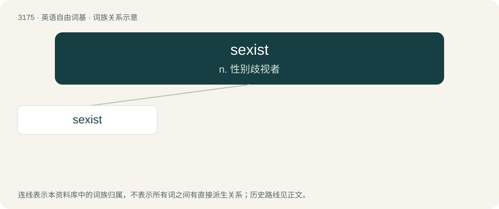

# 3276 · sexist — n. 性别歧视者

[总目录](../00_总目录_按常用程度.md)

**类型**：英语自由词基　｜　**来源语言**：见词源记录

## 核心含义与来源

- 核心含义：n. 性别歧视者
- 英文含义：Unfairly discriminatory against one sex in favour of the other.
- 词形：sexist

**来源记录 1**（形容词；Unfairly discriminatory against one sex in favour of the other.）

From sex + -ist, after sexism.

## 词族图

## 单词速览（常用到不常用）

| 单词 | 音标 | 释义 |
|---|---|---|
| [sexist](#w-1) | 英 /ˈsɛksɪst/ | n. 性别歧视者 |

## 逐词详解

### 1. sexist

**词性**：形容词　｜　**音标**：英 /ˈsɛksɪst/

**中文释义**：n. 性别歧视者

**英文义项**：Unfairly discriminatory against one sex in favour of the other.

**构词拆分**：sex + -ist

**词源与演化**：

From sex + -ist, after sexism.

**例句**：

> How come only girls get to be vampire slayers? That's so sexist!
