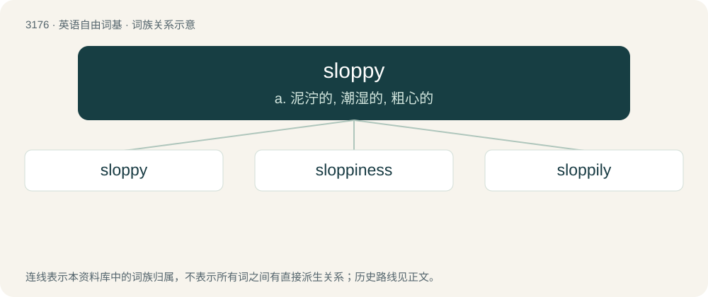

# 3277 · sloppy — a. 泥泞的, 潮湿的, 粗心的

[总目录](../00_总目录_按常用程度.md)

**类型**：英语自由词基　｜　**来源语言**：见词源记录

## 核心含义与来源

- 核心含义：a. 泥泞的, 潮湿的, 粗心的
- 英文含义：Composed of or covered in slop; very wet.
- 词形：sloppy

**来源记录 1**（形容词；Composed of or covered in slop; very wet.）

From slop + -y.

## 词族图

## 单词速览（常用到不常用）

| 单词 | 音标 | 释义 |
|---|---|---|
| [sloppy](#w-1) | 英 /ˈslɒ.pi/；美 /ˈslɑ.pi/ | a. 泥泞的, 潮湿的, 粗心的 |
| [sloppiness](#w-2) |  | n. 凌乱；马虎 |
| [sloppily](#w-3) | 英 /ˈslɒpɪli/；美 /ˈslɑpɪli/ | adv. 马虎地, 草率地 |

## 逐词详解

### 1. sloppy

**词性**：形容词　｜　**音标**：英 /ˈslɒ.pi/；美 /ˈslɑ.pi/

**中文释义**：a. 泥泞的, 潮湿的, 粗心的

**英文义项**：Composed of or covered in slop; very wet. / Careless, messy; not neat, elegant, or careful.

**构词拆分**：slop + -y

**词源与演化**：

From slop + -y.

**例句**：

> The carpenter did a sloppy job of building the staircase.

该用例对应义项：Careless, messy; not neat, elegant, or careful.

### 2. sloppiness

**词性**：名词

**中文释义**：n. 凌乱；马虎

**英文义项**：The property of being sloppy. / The result or product of being sloppy.

**构词拆分**：sloppy + -ness

**词源与演化**：

From sloppy + -ness.

**例句**：

> Performance and responsibility are not in their vocabulary; sloppiness comes as standard.

### 3. sloppily

**词性**：副词　｜　**音标**：英 /ˈslɒpɪli/；美 /ˈslɑpɪli/

**中文释义**：adv. 马虎地, 草率地

**英文义项**：In a sloppy manner, not neatly.

**构词拆分**：sloppy + -ly

**词源与演化**：

From sloppy + -ly.

**例句**：

> This work was done rather sloppily.

该用例对应义项：in a sloppy manner
