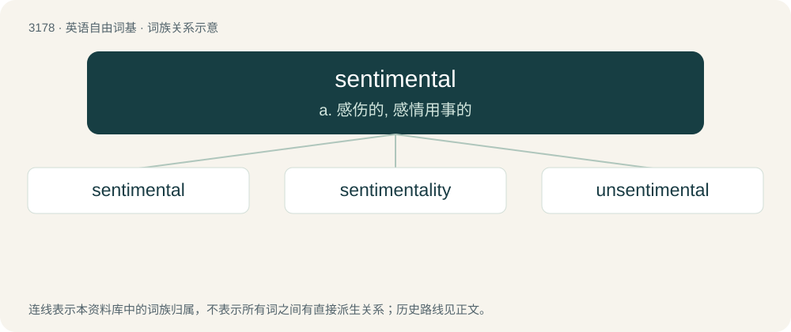

# 3278 · sentimental — a. 感伤的, 感情用事的

[总目录](../00_总目录_按常用程度.md)

**类型**：英语自由词基　｜　**来源语言**：见词源记录

## 核心含义与来源

- 核心含义：a. 感伤的, 感情用事的
- 英文含义：Characterized by sentiment, sentimentality or excess emotion; appealing to the emotions (especially tender emotions) rather than reason, morality, aesthetic taste, etc.
- 词形：sentimental

**来源记录 1**（形容词；Characterized by sentiment, sentimentality or excess emotion; appealing to the emotions (especially tender emotions) rather than reason, morality, aesthetic taste, etc.）

From sentiment + -al.

## 词族图

## 单词速览（常用到不常用）

| 单词 | 音标 | 释义 |
|---|---|---|
| [sentimental](#w-1) | 英 /ˌsɛntiˈmɛntl̩/；美 /ˌsɛntiˈmɛntl̩/ | a. 感伤的, 感情用事的 |
| [sentimentality](#w-2) | /.sentimenˈtæliti/ | n. 多愁善感；\[医\] 情感生活 |
| [unsentimental](#w-3) | /ˌʌnˌsentɪˈmentl/ | a. 不动感情的 |

## 逐词详解

### 1. sentimental

**词性**：形容词　｜　**音标**：英 /ˌsɛntiˈmɛntl̩/；美 /ˌsɛntiˈmɛntl̩/

**中文释义**：a. 感伤的, 感情用事的

**英文义项**：Characterized by sentiment, sentimentality or excess emotion; appealing to the emotions (especially tender emotions) rather than reason, morality, aesthetic taste, etc. / Derived from emotion rather than logical reason.

**构词拆分**：sentiment + -al

**词源与演化**：

From sentiment + -al.

**例句**：

> Sami things that were very sentimental for him in that box.

### 2. sentimentality

**词性**：名词　｜　**音标**：/.sentimenˈtæliti/

**中文释义**：n. 多愁善感；\[医\] 情感生活

**英文义项**：An act or state of being sentimental.

**构词拆分**：sentimental + -ity

**词源与演化**：

From sentimental + -ity. The music sense is a calque of German Empfindsamkeit.

**例句**：

> We don't have time to indulge in sentimentality.

### 3. unsentimental

**词性**：形容词　｜　**音标**：/ˌʌnˌsentɪˈmentl/

**中文释义**：a. 不动感情的

**英文义项**：Not sentimental.

**构词拆分**：un- + sentimental

**词源与演化**：

From un- + sentimental.
