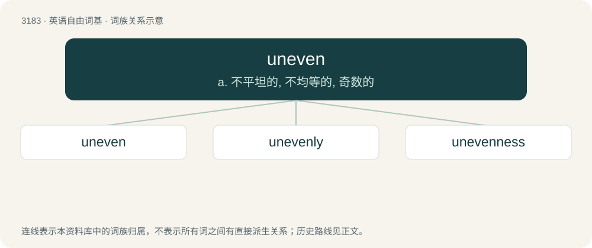

# 3280 · uneven — a. 不平坦的, 不均等的, 奇数的

[总目录](../00_总目录_按常用程度.md)

**类型**：英语自由词基　｜　**来源语言**：见词源记录

## 核心含义与来源

- 核心含义：a. 不平坦的, 不均等的, 奇数的
- 英文含义：Of a surface, not even; covered with raised spots, pits and grooves.
- 词形：uneven

**来源记录 1**（形容词；Of a surface, not even; covered with raised spots, pits and grooves.）

From Middle English uneven, from Old English unefen (“unequal, unlike, dissimilar, diverse, irregular”), equivalent to un- + even. Cognate with Dutch oneven (“unequal, uneven, odd”), German uneben (“uneven, rough, irregular, bumpy”).

## 词族图

## 单词速览（常用到不常用）

| 单词 | 音标 | 释义 |
|---|---|---|
| [uneven](#w-1) | /ʌnˈivən/ | a. 不平坦的, 不均等的, 奇数的 |
| [unevenly](#w-2) | /ʌnˈivənli/ | adv. 不平坦地；不均衡地；不平行地 |
| [unevenness](#w-3) | /ˈʌnˈiːvənis/ | \[化\] 不齐; 不匀度 |

## 逐词详解

### 1. uneven

**词性**：形容词　｜　**音标**：/ʌnˈivən/

**中文释义**：a. 不平坦的, 不均等的, 奇数的

**英文义项**：Of a surface, not even; covered with raised spots, pits and grooves. / Not level or smooth.

**构词拆分**：un- + even

**词源与演化**：

From Middle English uneven, from Old English unefen (“unequal, unlike, dissimilar, diverse, irregular”), equivalent to un- + even. Cognate with Dutch oneven (“unequal, uneven, odd”), German uneben (“uneven, rough, irregular, bumpy”).

**例句**：

> Wood with an uneven grain.

该用例对应义项：not even or uniform as e.g. in shape or texture

### 2. unevenly

**词性**：副词　｜　**音标**：/ʌnˈivənli/

**中文释义**：adv. 不平坦地；不均衡地；不平行地

**英文义项**：In an uneven or haphazard manner. / In an unequal manner.

**构词拆分**：uneven + -ly；un- + evenly

**词源与演化**：

From uneven + -ly or un- + evenly.

**例句**：

> Profits were distributed unevenly.

该用例对应义项：in an unequal or partial manner

### 3. unevenness

**词性**：名词　｜　**音标**：/ˈʌnˈiːvənis/

**中文释义**：\[化\] 不齐; 不匀度

**英文义项**：The quality or characteristic of being uneven; irregularity; inconsistency; the lack of smoothness or continuity. / The result or product of being uneven.

**构词拆分**：uneven + -ness

**词源与演化**：

From Middle English unevennesse, equivalent to uneven + -ness.

**例句**：

> The unevenness of his voice betrayed his nervousness.

该用例对应义项：The quality or characteristic of being uneven; irregularity; inconsistency; the lack of smoothness or continuity.
