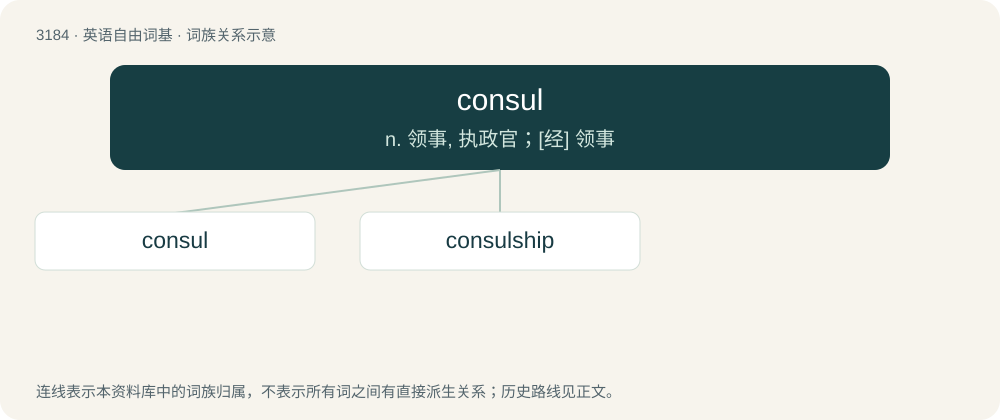

# 3281 · consul — n. 领事, 执政官；\[经\] 领事

[总目录](../00_总目录_按常用程度.md)

**类型**：英语自由词基　｜　**来源语言**：见词源记录

## 核心含义与来源

- 核心含义：n. 领事, 执政官；\[经\] 领事
- 英文含义：An official residing in major foreign towns to represent and protect the interests of the merchants and citizens of their country.
- 词形：consul

**来源记录 1**（名词；An official residing in major foreign towns to represent and protect the interests of the merchants and citizens of their country.）

From Middle English consul, from Old English consul, from Latin cōnsul.

## 词族图

## 单词速览（常用到不常用）

| 单词 | 音标 | 释义 |
|---|---|---|
| [consul](#w-1) | 英 /ˈkɒn.səl/；美 /ˈkɑn.səl/ | n. 领事, 执政官；\[经\] 领事 |
| [consulship](#w-2) | /ˈkɒnsəlʃip/ | n. 领事的职位, 领事的任期；\[法\] 领事的职位或任期 |

## 逐词详解

### 1. consul

**词性**：名词　｜　**音标**：英 /ˈkɒn.səl/；美 /ˈkɑn.səl/

**中文释义**：n. 领事, 执政官；\[经\] 领事

**英文义项**：An official residing in major foreign towns to represent and protect the interests of the merchants and citizens of their country.

**词源与演化**：

From Middle English consul, from Old English consul, from Latin cōnsul.

**例句**：

> The Roman consul had the camp placed not far from the enemy.

### 2. consulship

**词性**：名词　｜　**音标**：/ˈkɒnsəlʃip/

**中文释义**：n. 领事的职位, 领事的任期；\[法\] 领事的职位或任期

**英文义项**：The office of a consul, in its various senses. / The term of office of a consul.

**构词拆分**：consul + -ship

**词源与演化**：

From consul + -ship.
