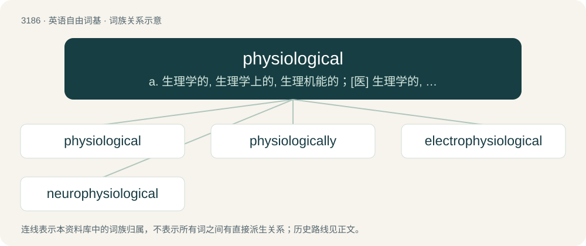

# 3283 · physiological — a. 生理学的, 生理学上的, 生理机能的；\[医\] 生理学的, 生理的

[总目录](../00_总目录_按常用程度.md)

**类型**：英语自由词基　｜　**来源语言**：见词源记录

## 核心含义与来源

- 核心含义：a. 生理学的, 生理学上的, 生理机能的；\[医\] 生理学的, 生理的
- 英文含义：Of, or relating to physiology.
- 词形：physiological

**来源记录 1**（形容词；Of, or relating to physiology.）

Either from physio- + -logical (equivalent to physiology + -ical) or Latin physiologicus + -al.

## 词族图

## 单词速览（常用到不常用）

| 单词 | 音标 | 释义 |
|---|---|---|
| [physiological](#w-1) | 英 /ˌfɪz.i.əˈlɒd͡ʒ.i.kəl/；美 /ˌfɪz.i.əˈlɑ.d͡ʒɪ.kəl/ | a. 生理学的, 生理学上的, 生理机能的；\[医\] 生理学的, 生理的 |
| [physiologically](#w-2) |  | adv. 生理学方面 |
| [electrophysiological](#w-3) | /iˈlektrəj,fiziəˈlɔdʒikəl/ | a. \[物\]电生理学的 |
| [neurophysiological](#w-4) |  | a. 神经生理学的; 神经生理的 |

## 逐词详解

### 1. physiological

**词性**：形容词　｜　**音标**：英 /ˌfɪz.i.əˈlɒd͡ʒ.i.kəl/；美 /ˌfɪz.i.əˈlɑ.d͡ʒɪ.kəl/

**中文释义**：a. 生理学的, 生理学上的, 生理机能的；\[医\] 生理学的, 生理的

**英文义项**：Of, or relating to physiology. / Relating to the action of a drug when given to a healthy person, as distinguished from its therapeutic action.

**构词拆分**：physio- + -logical + physiology + -ical + -al；physio- + -logical；physiology + -ical

**词源与演化**：

Either from physio- + -logical (equivalent to physiology + -ical) or Latin physiologicus + -al.

**例句**：

> My attitude to the comma is physiological; the more breath I have, the fewer commas I use.

### 2. physiologically

**词性**：副词

**中文释义**：adv. 生理学方面

**英文义项**：In accordance with the science of physiology. / In a manner pertaining to an organism's physiology.

**构词拆分**：physiological + -ly

**词源与演化**：

From physiological + -ly.

### 3. electrophysiological

**词性**：形容词　｜　**音标**：/iˈlektrəj,fiziəˈlɔdʒikəl/

**中文释义**：a. \[物\]电生理学的

**英文义项**：of or pertaining to electrophysiology

**构词拆分**：electro- + physiological

**词源与演化**：

From electro- + physiological.

### 4. neurophysiological

**词性**：形容词

**中文释义**：a. 神经生理学的; 神经生理的

**英文义项**：Of or pertaining to neurophysiology.

**构词拆分**：neuro- + physiological + neurophysiology + -ical

**词源与演化**：

From neuro- + physiological. By surface analysis, neurophysiology + -ical.
