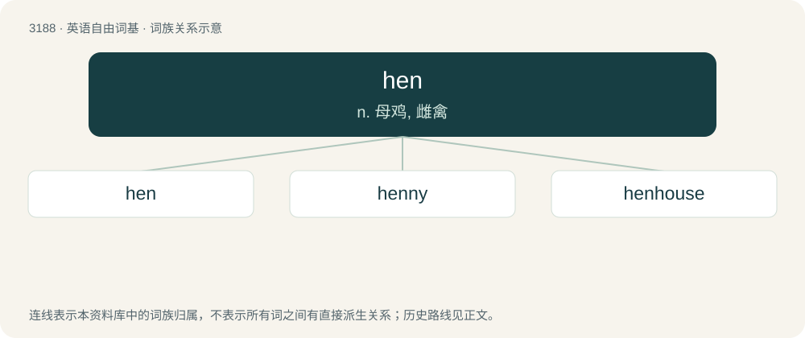

# 3284 · hen — n. 母鸡, 雌禽

[总目录](../00_总目录_按常用程度.md)

**类型**：英语自由词基　｜　**来源语言**：见词源记录

## 核心含义与来源

- 核心含义：n. 母鸡, 雌禽
- 英文含义：A female chicken (Gallus gallus), especially a sexually mature one kept for her eggs.
- 词形：hen

**多个词源／构词路径**：同一拼写可能有不同来源；以下按词性和含义分别列出。

**来源记录 1**（名词；A female chicken (Gallus gallus), especially a sexually mature one kept for her eggs.）

From Middle English hen, from Old English henn (“hen”), from Proto-West Germanic \*hannju, from Proto-Germanic \*hanjō (“hen”), from Proto-Indo-European \*kan-, \*kana- (“to sing”). Cognate with Saterland Frisian Hanne (“hen”), West Frisian hin (“hen”), Dutch hen (“hen”), German Low German Heen (“hen”), German Henne (“hen”), Danish høne (“hen”), Swedish höna (“hen”), Icelandic hæna (“hen”). Related to Old English hana (“cock, rooster”). Also cognate to Latin cicōnia (“stork”), Latin canō (“to sing”), Russian каню́к (kanjúk, “buzzard”). Compare Russian пету́х (petúx, “rooster, cock”) from Russian петь (petʹ, “to sing”). Etymology 1, noun sense 7 after cock (“male chicken; man's penis”).

**来源记录 2**（副词；Hence.）

From Middle English henne, heonne, hinne, from earlier henene, heonenen, henen, from Old English heonan, hionan, heonane, heonone (“hence, from here, away, from how”), from Proto-Germanic \*hina, \*hinanō (“from here”), from Proto-Indo-European \*ḱe-, \*ḱey- (“this, here”). Cognate with Dutch heen (“away”), German hin (“hence, from here”), Danish hen (“away, further, on”). See also hence.

**来源记录 3**（动词；To throw.）

From hen (“hence, away”), or a variant of hench.

## 词族图

## 单词速览（常用到不常用）

| 单词 | 音标 | 释义 |
|---|---|---|
| [hen](#w-1) | 英 /hɛn/；美 /hɪn/ | n. 母鸡, 雌禽 |
| [henny](#w-2) | /ˈhɛni/ | 【英文】Resembling or characteristic of a hen. |
| [henhouse](#w-3) | /ˈhenhaus/ | n. 鸡舍 |

## 逐词详解

### 1. hen

**词性**：名词　｜　**音标**：英 /hɛn/；美 /hɪn/

**中文释义**：n. 母鸡, 雌禽

**英文义项**：A female chicken (Gallus gallus), especially a sexually mature one kept for her eggs. / A female of other bird species, particularly a sexually mature female fowl.

**词源与演化**：

From Middle English hen, from Old English henn (“hen”), from Proto-West Germanic \*hannju, from Proto-Germanic \*hanjō (“hen”), from Proto-Indo-European \*kan-, \*kana- (“to sing”). Cognate with Saterland Frisian Hanne (“hen”), West Frisian hin (“hen”), Dutch hen (“hen”), German Low German Heen (“hen”), German Henne (“hen”), Danish høne (“hen”), Swedish höna (“hen”), Icelandic hæna (“hen”). Related to Old English hana (“cock, rooster”). Also cognate to Latin cicōnia (“stork”), Latin canō (“to sing”), Russian каню́к (kanjúk, “buzzard”). Compare Russian пету́х (petúx, “rooster, cock”) from Russian петь (petʹ, “to sing”). Etymology 1, noun sense 7 after cock (“male chicken; man's penis”).

**例句**：

> Don't cry, hen. Everything will be all right.

该用例对应义项：An affectionate term of address used to women or girls.

### 2. henny

**词性**：形容词　｜　**音标**：/ˈhɛni/

**英文义项**：Resembling or characteristic of a hen.

**构词拆分**：hen + -y

**词源与演化**：

From hen + -y.

### 3. henhouse

**词性**：名词　｜　**音标**：/ˈhenhaus/

**中文释义**：n. 鸡舍

**英文义项**：Synonym of hencoop.

**构词拆分**：hen + house

**词源与演化**：

From hen + house.

**例句**：

> There are about seventy hens in the henhouse, but only one rooster.
