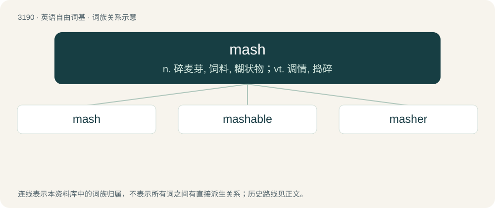

# 3286 · mash — n. 碎麦芽, 饲料, 糊状物；vt. 调情, 捣碎

[总目录](../00_总目录_按常用程度.md)

**类型**：英语自由词基　｜　**来源语言**：见词源记录

## 核心含义与来源

- 核心含义：n. 碎麦芽, 饲料, 糊状物；vt. 调情, 捣碎
- 英文含义：A mass of mixed ingredients reduced to a soft pulpy state by beating or pressure; a mass of anything in a soft pulpy state.
- 词形：mash

**多个词源／构词路径**：同一拼写可能有不同来源；以下按词性和含义分别列出。

**来源记录 1**（名词；A mass of mixed ingredients reduced to a soft pulpy state by beating or pressure; a mass of anything in a soft pulpy state.）

From Middle English mash, from Old English mǣsċ, māsċ, māx, from Proto-Germanic \*maiskaz, \*maiskō (“mixture, mash”), from Proto-Indo-European \*meyǵ-, \*meyḱ- (“to mix”). Akin to German Meisch, Maische (“mash”), (compare meischen, maischen (“to mash, wash”)), Swedish mäsk (“mash”), and to Old English miscian (“to mix”). See mix.

**来源记录 2**（动词；To convert into a mash; to reduce to a soft pulpy state by beating or pressure）

From Middle English mashen, maschen, meshen, from Old English \*māsċan, \*mǣsċan, from Proto-Germanic \*maiskijaną. Cognate with German maischen. Compare also Middle Low German meskewert, mēschewert (“beerwort”).

**来源记录 3**（动词；To flirt, to make eyes, to make romantic advances.）

Either by analogy with mash (“to press, to soften”), or more likely from Romani masha (“a fascinator, an enticer”), mashdva (“fascination, enticement”). Originally used in theater, and recorded in US in 1870s. Either originally used as mash, or a backformation from masher, from masha. Leland writes of the etymology: : It was introduced by the well-known gypsy family of actors, C., among whom Romany was habitually spoken. The word “masher” or “mash” means in that tongue to allure, delude, or entice. It was doubtless much aided in its popularity by its quasi-identity with the English word. But there can be no doubt as to the gypsy origin of “mash” as used on the stage. I am indebted for this information to the late well-known impresario \[Albert Marshall\] Palmer of New York, and I made a note of it years before the term had become at all popular.

**来源记录 4**（名词；A gun.）

Mostly clipping of machine gun, but also for imitative reasons, compare the gun-names mop and broom; intentionally chosen around 2000 due to its homonymy and obscurity for legal reasons.

## 词族图

## 单词速览（常用到不常用）

| 单词 | 音标 | 释义 |
|---|---|---|
| [mash](#w-1) | /mæʃ/ | n. 碎麦芽, 饲料, 糊状物；vt. 调情, 捣碎 |
| [mashable](#w-2) |  | 【英文】Of a consistency suitable for mashing. |
| [masher](#w-3) | /ˈmæʃə(ɹ)/ | n. 捣碎者, 捣碎器, 调情求爱者 |

## 逐词详解

### 1. mash

**词性**：名词　｜　**音标**：/mæʃ/

**中文释义**：n. 碎麦芽, 饲料, 糊状物；vt. 调情, 捣碎

**英文义项**：A mass of mixed ingredients reduced to a soft pulpy state by beating or pressure; a mass of anything in a soft pulpy state. / Ground or bruised malt, or meal of rye, wheat, corn, or other grain (or a mixture of malt and meal) steeped and stirred in hot water for making the wort.

**词源与演化**：

From Middle English mash, from Old English mǣsċ, māsċ, māx, from Proto-Germanic \*maiskaz, \*maiskō (“mixture, mash”), from Proto-Indo-European \*meyǵ-, \*meyḱ- (“to mix”). Akin to German Meisch, Maische (“mash”), (compare meischen, maischen (“to mash, wash”)), Swedish mäsk (“mash”), and to Old English miscian (“to mix”). See mix.

**例句**：

> Mash this sprout with a little salt and rub it on the swollen part.

### 2. mashable

**词性**：形容词

**英文义项**：Of a consistency suitable for mashing. / Suitable for inclusion in a mashup.

**构词拆分**：mash + -able

**词源与演化**：

From mash + -able.

### 3. masher

**词性**：名词　｜　**音标**：/ˈmæʃə(ɹ)/

**中文释义**：n. 捣碎者, 捣碎器, 调情求爱者

**英文义项**：One who, or that which, mashes. / A machine for making mash.

**构词拆分**：From mash + -er.

**词源与演化**：

From mash + -er.

**例句**：

> To make fig jam, Yanni mashed the figs with a potato masher.
