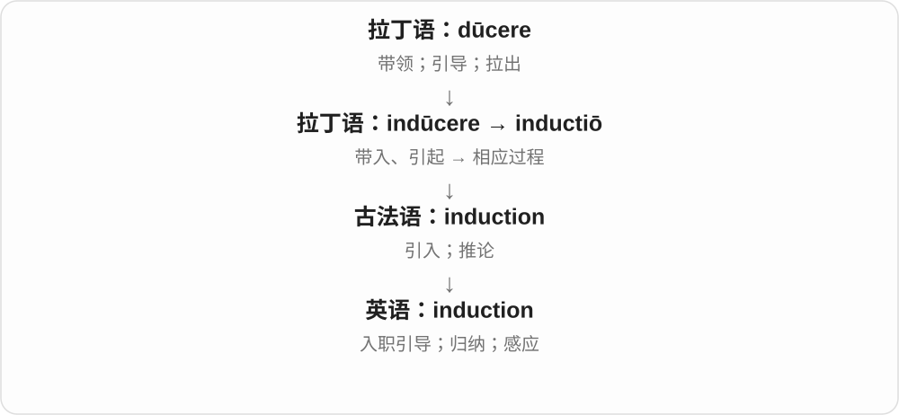

# 3287 · induction — 引入、引导进入，由具体导入走向多种专业过程

[逐词精讲目录](../00_逐词精讲目录.md) · [总目录](../00_总目录_按常用程度.md)

## 核心词根与来源

新员工被引入岗位是入职培训，从一些实例走向一般判断是归纳，电磁感应则是物理固定术语。不能只用一个汉语词包住所有领域。

**INDUCTION：把什么引入，要看领域**

induction 在入职、推理、电磁等场景中分别理解。

- **导入与领域专门义**：induction

## 词形与演化规律

拉丁 inducere、inductio 等引入材料 → induction。现代理解须对照 employment、reasoning、electromagnetic 等限定。

## 单词速览（按词族由简到繁）

同一基础词的相关扩展放在一起，先读基础形式，再读扩展；各组之间优先读常用的。具体词源关系见各词讲解。

| 单词 | 音标 | 核心意思 |
|---|---|---|
| [induction](#w-1) | /ɪnˈdʌkʃən/ | 入职引导；归纳；感应；诱导 |

## 逐词讲解

### 1. induction — 入职引导；归纳；感应；诱导

**音标**：/ɪnˈdʌkʃən/

**先抓住这个画面**

induction 有几种常见场景：把新人带进工作，把观察带向一般判断，或通过某种作用引出一个反应。

**怎么拆**

经法语来自拉丁语 inductiō，与 indūcere“带入、引起”相连。用 induct- 看出它和 induce 的关系即可。

**怎么变成今天的意思**

入职培训是让人进入角色；归纳是从具体观察形成较一般的判断；电磁感应是另一种专门用法。这些意思不能只背一个“引入”就代替实际理解。

**常见搭配与例句**

an induction course（入职培训课程）；inductive reasoning / induction（归纳推理）；electromagnetic induction（电磁感应）。

> All new staff attend an induction course.

所有新员工都参加入职培训。

> The class compared induction with deduction.

课堂上比较了归纳推理和演绎推理。

**别混淆**

普通经验归纳不能保证结论必然为真；数学里的 mathematical induction“数学归纳法”是严格证明方法，要另行学习。

## 这一组要分清什么

归纳与演绎不同；induction 的物理义也不是普通引导员工的字面过程。

## 串起来练习

The word induction has different meanings in staff training and physics.

induction 在员工培训和物理学里有不同意思。
