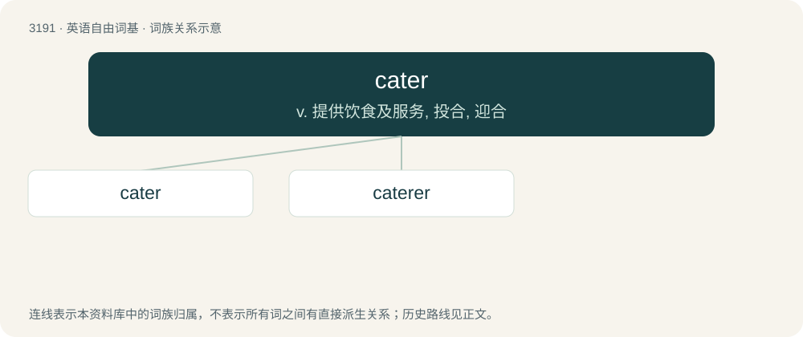

# 3288 · cater — v. 提供饮食及服务, 投合, 迎合

[总目录](../00_总目录_按常用程度.md)

**类型**：英语自由词基　｜　**来源语言**：见词源记录

## 核心含义与来源

- 核心含义：v. 提供饮食及服务, 投合, 迎合
- 英文含义：To provide, particularly
- 词形：cater

**多个词源／构词路径**：同一拼写可能有不同来源；以下按词性和含义分别列出。

**来源记录 1**（动词；To provide, particularly）

From Middle English catour (“acater, provisioner”), aphetic form of acatour (“acater”), from Old French acater (“to buy, to purchase”). Equivalent to cate + -er.

**来源记录 2**（动词；To place, set, move, or cut diagonally or rhomboidally.）

Probably ultimately from French quatre (“four”), possibly via cater (“change-ringing”), although Liberman argues for a derivation from a North Germanic prefix meaning "crooked, angled, clumsy" from which he also derives cater-cousin and, via Norse, Old Irish cittach (“left-handed, awkward”). He finds this more likely than extension of the dice and change-ringing term cater as an adverb, given the likely cognates in other Germanic languages. Caterpillar and caterwaul are unrelated, being derived from cognates to cat, but may have influenced the pronunciation of Liberman's proposed earlier \*cate- or undergone similar sound changes.

**来源记录 3**（名词；A method of ringing nine bells in four pairs with a ninth tenor bell.）

From French quatre (“four”). Doublet of cuatro.

## 词族图

## 单词速览（常用到不常用）

| 单词 | 音标 | 释义 |
|---|---|---|
| [cater](#w-1) | 英 /ˈkeɪtə/；美 /ˈkeɪɾɚ/ | v. 提供饮食及服务, 投合, 迎合 |
| [caterer](#w-2) | 美 /ˈkeɪtəɹɚ/ | n. 备办食物者, 备办宴席者 |

## 逐词详解

### 1. cater

**词性**：动词　｜　**音标**：英 /ˈkeɪtə/；美 /ˈkeɪɾɚ/

**中文释义**：v. 提供饮食及服务, 投合, 迎合

**英文义项**：To provide, particularly / To provide with food, especially for a special occasion as a professional service.

**构词拆分**：cate + -er

**词源与演化**：

From Middle English catour (“acater, provisioner”), aphetic form of acatour (“acater”), from Old French acater (“to buy, to purchase”). Equivalent to cate + -er.

**例句**：

> I always wanted someone to cater to my every whim.

该用例对应义项：To provide anything required or desired, often (derogatory) to pander.

### 2. caterer

**词性**：名词　｜　**音标**：美 /ˈkeɪtəɹɚ/

**中文释义**：n. 备办食物者, 备办宴席者

**英文义项**：A person employed to obtain and maintain the storage of provisions, especially food. / A person or company hired to provide and serve food, usually for a large group and at a location separate from where the food is prepared.

**构词拆分**：cater + -er

**词源与演化**：

From cater + -er.

**例句**：

> Markku made his pile as a caterer for the well-to-do.
