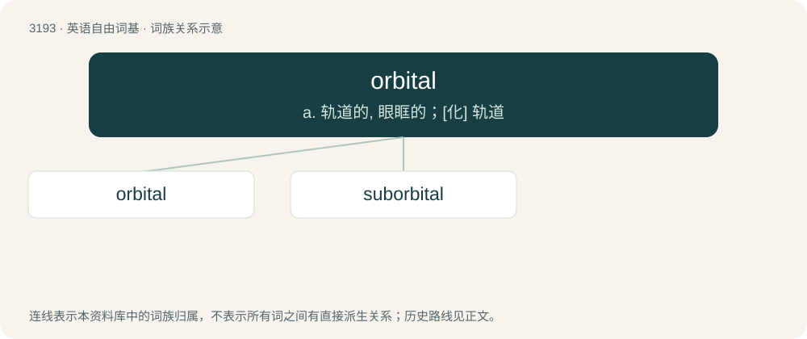

# 3291 · orbital — a. 轨道的, 眼眶的；\[化\] 轨道

[总目录](../00_总目录_按常用程度.md)

**类型**：英语自由词基　｜　**来源语言**：见词源记录

## 核心含义与来源

- 核心含义：a. 轨道的, 眼眶的；\[化\] 轨道
- 英文含义：Of or relating to, or forming an orbit (such as the orbit of a moon, planet, or spacecraft).
- 词形：orbital

**来源记录 1**（形容词；Of or relating to, or forming an orbit (such as the orbit of a moon, planet, or spacecraft).）

Borrowed from Medieval Latin orbitālis, from orbita (“a track or rut; a circuit, orbit”) + -ālis (“-al”, adjectival suffix), equivalent to orbit + -al. Doublet of orbitalis.

## 词族图

## 单词速览（常用到不常用）

| 单词 | 音标 | 释义 |
|---|---|---|
| [orbital](#w-1) | 英 /ɔː.bɪt.əl/；美 /ɔɹ.bət.l̩/ | a. 轨道的, 眼眶的；\[化\] 轨道 |
| [suborbital](#w-2) | /sʌbˈɔːbitl/ | a. 眼眶下面的, 眼睛下面的, 不满轨道一整圈的；\[医\] 眶下的 |

## 逐词详解

### 1. orbital

**词性**：形容词　｜　**音标**：英 /ɔː.bɪt.əl/；美 /ɔɹ.bət.l̩/

**中文释义**：a. 轨道的, 眼眶的；\[化\] 轨道

**英文义项**：Of or relating to, or forming an orbit (such as the orbit of a moon, planet, or spacecraft). / Of or relating to the eye socket (eyehole).

**构词拆分**：orbit + -al

**词源与演化**：

Borrowed from Medieval Latin orbitālis, from orbita (“a track or rut; a circuit, orbit”) + -ālis (“-al”, adjectival suffix), equivalent to orbit + -al. Doublet of orbitalis.

**例句**：

> The M25 is an orbital motorway around London.

该用例对应义项：(of roads, railways) Passing around the outside of an urban area.

### 2. suborbital

**词性**：形容词　｜　**音标**：/sʌbˈɔːbitl/

**中文释义**：a. 眼眶下面的, 眼睛下面的, 不满轨道一整圈的；\[医\] 眶下的

**英文义项**：Not reaching orbit; having a trajectory that does not reach orbital velocity and so must return to ground eventually. / Below the orbit of the eye.

**构词拆分**：sub- + orbital

**词源与演化**：

From sub- + orbital.

**例句**：

> The first rocket test was suborbital; it didn't even get off the ground but rather exploded on the launchpad.

该用例对应义项：Not reaching orbit; having a trajectory that does not reach orbital velocity and so must return to ground eventually.
