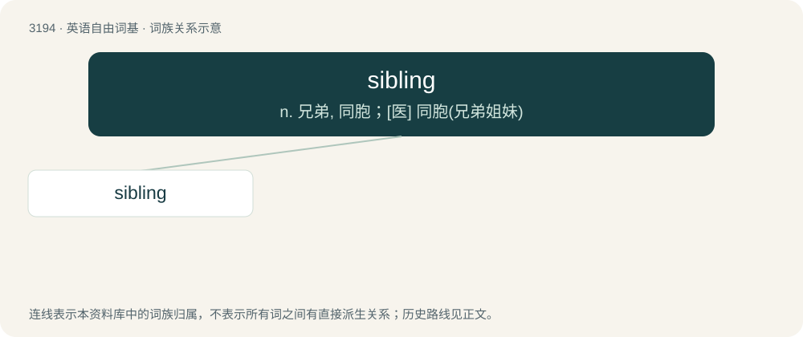

# 3293 · sibling — n. 兄弟, 同胞；\[医\] 同胞(兄弟姐妹)

[总目录](../00_总目录_按常用程度.md)

**类型**：英语自由词基　｜　**来源语言**：见词源记录

## 核心含义与来源

- 核心含义：n. 兄弟, 同胞；\[医\] 同胞(兄弟姐妹)
- 英文含义：A person who shares a parent; one's brother or sister who one shares a parent with.
- 词形：sibling

**来源记录 1**（名词；A person who shares a parent; one's brother or sister who one shares a parent with.）

First use appears c. 1903, a modern revival of Old English sibling (“relative, a relation, kinsman”), equivalent to sib + -ling. Compare Middle English siblynges pl, sib, sibbe (“relative; kinsman”), German Sippe. The term apparently meant merely kin or relative until the 20th century when it was applied in a way that aided the study of genetics, which led to its specialized use. For example, the OED has a citation in 1902 in which sibling must be defined for those who do not know the intended meaning.

## 词族图

## 单词速览（常用到不常用）

| 单词 | 音标 | 释义 |
|---|---|---|
| [sibling](#w-1) | /ˈsɪb.lɪŋ/ | n. 兄弟, 同胞；\[医\] 同胞(兄弟姐妹) |

## 逐词详解

### 1. sibling

**词性**：名词　｜　**音标**：/ˈsɪb.lɪŋ/

**中文释义**：n. 兄弟, 同胞；\[医\] 同胞(兄弟姐妹)

**英文义项**：A person who shares a parent; one's brother or sister who one shares a parent with. / A node in a data structure that shares its parent with another node.

**构词拆分**：sib + -ling

**词源与演化**：

First use appears c. 1903, a modern revival of Old English sibling (“relative, a relation, kinsman”), equivalent to sib + -ling. Compare Middle English siblynges pl, sib, sibbe (“relative; kinsman”), German Sippe. The term apparently meant merely kin or relative until the 20th century when it was applied in a way that aided the study of genetics, which led to its specialized use. For example, the OED has a citation in 1902 in which sibling must be defined for those who do not know the intended meaning.

**例句**：

> None of my siblings are married yet.

该用例对应义项：A person who shares a parent; one's brother or sister who one shares a parent with.
