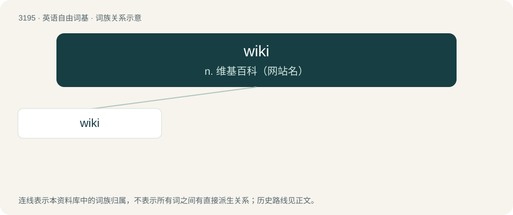

# 3294 · wiki — n. 维基百科（网站名）

[总目录](../00_总目录_按常用程度.md)

**类型**：英语自由词基　｜　**来源语言**：见词源记录

## 核心含义与来源

- 核心含义：n. 维基百科（网站名）
- 英文含义：A collaborative website which can be directly edited merely by using a web browser, often by anyone who has access to it.
- 词形：wiki

**来源记录 1**（名词；A collaborative website which can be directly edited merely by using a web browser, often by anyone who has access to it.）

First appearance in 1995 in PC Week. Abbreviated from WikiWikiWeb, from Hawaiian wikiwiki (“quick”) + English web.

## 词族图

## 单词速览（常用到不常用）

| 单词 | 音标 | 释义 |
|---|---|---|
| [wiki](#w-1) | /ˈwɪki/ | n. 维基百科（网站名） |

## 逐词详解

### 1. wiki

**词性**：名词　｜　**音标**：/ˈwɪki/

**中文释义**：n. 维基百科（网站名）

**英文义项**：A collaborative website which can be directly edited merely by using a web browser, often by anyone who has access to it.

**词源与演化**：

First appearance in 1995 in PC Week. Abbreviated from WikiWikiWeb, from Hawaiian wikiwiki (“quick”) + English web.

**例句**：

> He spent time editing articles on the wiki.

该用例对应义项：A collaborative website which can be directly edited merely by using a web browser, often by anyone who has access to it.
