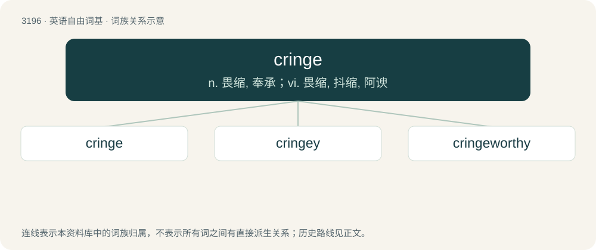

# 3295 · cringe — n. 畏缩, 奉承；vi. 畏缩, 抖缩, 阿谀

[总目录](../00_总目录_按常用程度.md)

**类型**：英语自由词基　｜　**来源语言**：见词源记录

## 核心含义与来源

- 核心含义：n. 畏缩, 奉承；vi. 畏缩, 抖缩, 阿谀
- 英文含义：To cower, flinch, recoil, shrink, or tense, as in disgust, embarrassment, or fear.
- 词形：cringe

**来源记录 1**（动词；To cower, flinch, recoil, shrink, or tense, as in disgust, embarrassment, or fear.）

The verb is derived from Middle English crengen (“to bend in a haughty manner; to condescend”) \[and other forms\], from Old English \*crenġan, \*crenċġan, \*crenċan (“to cause to fall or turn”) from Proto-Germanic \*krangijaną (“to cause to fall; to cause to turn”), causative of Proto-Germanic \*kringaną, \*krinkaną (“to fall; to turn; to yield”) (&gt; Old English crin(c)gan (“to yield; to cringe; to fall; to die, perish”)), from Proto-Indo-European \*grenǵʰ- (“to turn”)). The causative suffix is from \*-janą (suffix forming causatives with the sense ‘to cause to do (the action of the verb)’ from strong verbs). The English word is cognate with Danish krænge (“to turn inside out, evert”), Dutch krengen (“to careen, veer”) and Dutch kring (“circle”), Scots crenge, creenge, creinge, crienge (“to cringe; to shrug”), Swedish kränga (“to careen; to heel, lurch; to toss”), and West Frisian kringe (“to pinch; to poke; to push; to insist, urge”); and is a doublet of crinkle. The noun and adjective are derived from the verb via zero derivation.

## 词族图

## 单词速览（常用到不常用）

| 单词 | 音标 | 释义 |
|---|---|---|
| [cringe](#w-1) | /ˈkɹɪnd͡ʒ/ | n. 畏缩, 奉承；vi. 畏缩, 抖缩, 阿谀 |
| [cringey](#w-2) | /ˈkɹɪnd͡ʒi/ | 【英文】Characterised by causing feelings of embarrassment; embarrassing. |
| [cringeworthy](#w-3) | 英 /ˈkɹɪnd͡ʒˌwɜːði/；美 /ˈkɹɪnd͡ʒˌwɝði/ | 令人感到尴尬（或不舒服）的 |

## 逐词详解

### 1. cringe

**词性**：动词　｜　**音标**：/ˈkɹɪnd͡ʒ/

**中文释义**：n. 畏缩, 奉承；vi. 畏缩, 抖缩, 阿谀

**英文义项**：To cower, flinch, recoil, shrink, or tense, as in disgust, embarrassment, or fear. / To experience an inward feeling of disgust, embarrassment, or fear; (by extension) to feel very embarrassed.

**词源与演化**：

The verb is derived from Middle English crengen (“to bend in a haughty manner; to condescend”) \[and other forms\], from Old English \*crenġan, \*crenċġan, \*crenċan (“to cause to fall or turn”) from Proto-Germanic \*krangijaną (“to cause to fall; to cause to turn”), causative of Proto-Germanic \*kringaną, \*krinkaną (“to fall; to turn; to yield”) (&gt; Old English crin(c)gan (“to yield; to cringe; to fall; to die, perish”)), from Proto-Indo-European \*grenǵʰ- (“to turn”)). The causative suffix is from \*-janą (suffix forming causatives with the sense ‘to cause to do (the action of the verb)’ from strong verbs). The English word is cognate with Danish krænge (“to turn inside out, evert”), Dutch krengen (“to careen, veer”) and Dutch kring (“circle”), Scots crenge, creenge, creinge, crienge (“to cringe; to shrug”), Swedish kränga (“to careen; to heel, lurch; to toss”), and West Frisian kringe (“to pinch; to poke; to push; to insist, urge”); and is a doublet of crinkle. The noun and adjective are derived from the verb via zero derivation.

**例句**：

> When he runs his fingernails down the blackboard, it makes me cringe.

### 2. cringey

**词性**：形容词　｜　**音标**：/ˈkɹɪnd͡ʒi/

**英文义项**：Characterised by causing feelings of embarrassment; embarrassing. / Cringing; cowardly.

**构词拆分**：cringe + -y

**词源与演化**：

From cringe + -y.

**例句**：

> He's your typical stale, cringey know-it-all.

### 3. cringeworthy

**词性**：形容词　｜　**音标**：英 /ˈkɹɪnd͡ʒˌwɜːði/；美 /ˈkɹɪnd͡ʒˌwɝði/

**中文释义**：令人感到尴尬（或不舒服）的

**英文义项**：That causes or may cause one to cringe with disgust, embarrassment (often vicarious embarrassment), etc.; awkward, disgusting, embarrassing.

**构词拆分**：cringe + -worthy

**词源与演化**：

From cringe (verb) + -worthy (suffix meaning of ‘sufficient worth for, deserving of’), popularized by the surname of the character Cuthbert Cringeworthy, an extremely studious pupil introduced in 1972 into The Bash Street Kids, a comic strip by the Scottish cartoonist David Sutherland (1933–2023) published in the British magazine The Beano.

**例句**：

> This movie is an unwatchable, cringeworthy piece of shit.
