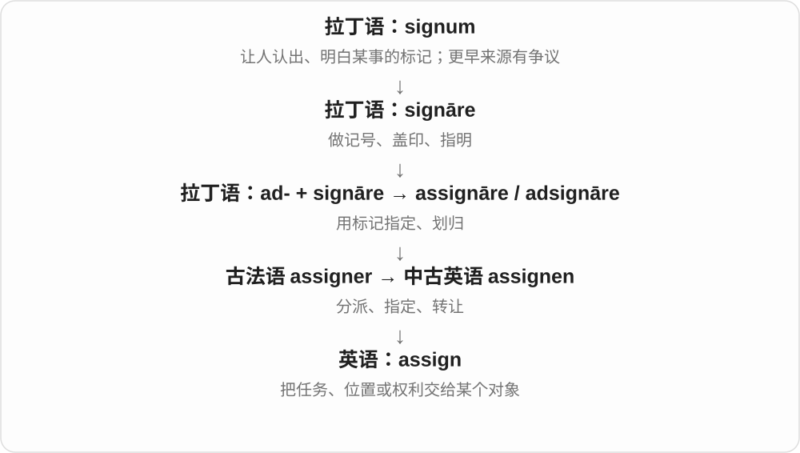
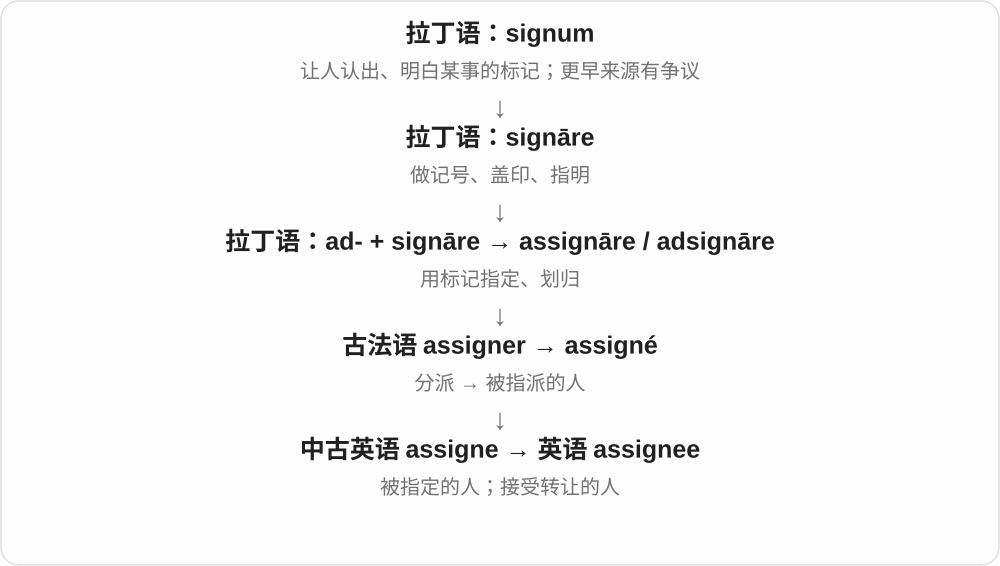
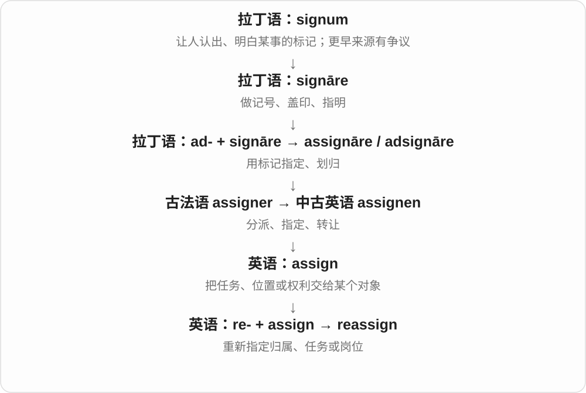

# 3296 · assign — 确定任务、资源归属，进入能力、人物与重新安排

[逐词精讲目录](../00_逐词精讲目录.md) · [总目录](../00_总目录_按常用程度.md)

## 核心词根与来源

任务、房间、按键功能都可以分配。分配动作、能否分配、被分配到的人与重新安排，是相连而不同的层次。

**ASSIGN：这件事，交给谁或定作什么用途**

assign → assignable、assignee；reassign 重新分配。

- **分配及相关能力、人物**：assign · assignable · assignee
- **重新安排**：reassign

## 词形与演化规律

拉丁 assignare → 法语相应形式 → assign；-able 可；-ee 接受者；re- 重新。

## 单词速览（按词族由简到繁）

同一基础词的相关扩展放在一起，先读基础形式，再读扩展；各组之间优先读常用的。具体词源关系见各词讲解。

| 单词 | 音标 | 核心意思 |
|---|---|---|
| [assign](#w-1) | /əˈsaɪn/ | 分配；指派；指定；转让 |
| [assignee](#w-3) | /ˌæsaɪˈniː/，也 /ˌæsəˈniː/ | 受让人；被指派任务的人 |
| [assignable](#w-4) | /əˈsaɪnəbəl/ | 可分配的；可指定、归属的；可转让的〔依语境〕 |
| [reassign](#w-2) | /ˌriːəˈsaɪn/ | 重新分配；改派 |

## 逐词讲解

### 1. assign — 分配；指派；指定；转让

**音标**：/əˈsaɪn/

**先抓住这个画面**

assign 像在表格里画连线：这项任务连到这个人，这个编号连到这个物品，让归属明确下来。

**怎么拆**

拉丁 ad- + signāre → assignāre，经古法语 assigner 进入中古英语；“用标记划归”可帮助理解现代分配义。

**怎么变成今天的意思**

assign a task to someone，也可 assign someone a task；assign a value 是给变量赋值；正式语境还可说转让权利。

**常见搭配与例句**

assign responsibility；assign a value；assign someone to a team。

> The teacher assigned each group a different topic.

老师给每组分配了不同主题。

> The system assigns a number to each new record.

系统给每条新记录分配一个编号。

**别混淆**

designate 常强调选定身份或用途；assign 常强调把任务、资源或值分配给具体对象。

### 2. assignee — 受让人；被指派任务的人

**音标**：/ˌæsaɪˈniː/，也 /ˌæsəˈniː/

**先抓住这个画面**

assignee 是箭头指向的接收端：任务交给谁，或者权利转给谁，那个人就是 assignee。

**怎么拆**

古法语 assigné 是 assigner 的过去分词，表示被指定者；借入英语后，现代可看作 assign + -ee。

**怎么变成今天的意思**

任务软件中的 assignee 是任务负责人；权利转让语境中是接受一方。词义本身不规定具体合同效力。

**常见搭配与例句**

the task’s assignee；name an assignee；the original assignee。

> The task has an assignee but no deadline yet.

这项任务已有负责人，但还没有截止日期。

> The document names the company as the assignee of the rights.

文件把该公司列为这些权利的受让方。

**别混淆**

assignor 是转出一方；assignee 是接收一方。-ee 常帮助你识别承受动作的人。

### 3. assignable — 可分配的；可指定、归属的；可转让的〔依语境〕

**音标**：/əˈsaɪnəbəl/

**先抓住这个画面**

任务可以指派给某个人，按键可以指定一种功能，都是 assignable。核心是能给它确定负责者、用途、归属。

**怎么拆**

assign + -able → assignable；assign 接拉丁 assignare 指派、指定材料，g 在这些现代形式中不发音。

**怎么变成今天的意思**

**拉丁 assignare 指定、分配等 → 法语、英语 assign**  
给任务、资源确定归属

↓

**assign + -able → assignable**  
可以分配、指定或转让的

an assignable task 可指派的任务；assignable buttons 可自定义分配功能的按钮；an assignable cause 可确定归属的原因，专门用法由领域限定。

**常见搭配与例句**

assignable tasks；assignable buttons；an assignable cause。

> The controller has four assignable buttons.

控制器有四个可自定义功能的按钮。

> Each task is assignable to a member of the team.

每项任务都可指派给团队中的一名成员。

**别混淆**

assignable 说能分配，assigned 说已经分配；可指定功能的按钮也不表示已经选好了功能。

### 4. reassign — 重新分配；改派

**音标**：/ˌriːəˈsaɪn/

**先抓住这个画面**

reassign 像把表格里的旧连线擦掉，换一个人接任务，或让原来的人去做别的工作。

**怎么拆**

re-（重新）+ assign，英语内部构词。

**怎么变成今天的意思**

reassign a task to someone 是把任务改派给某人；reassign someone to another team 是把某人调到另一组。

**常见搭配与例句**

reassign duties；reassign to；reassign a case。

> The manager reassigned the task to another team.

经理把任务改派给了另一组。

> She was reassigned to the research department.

她被调到研究部门。

**别混淆**

replace 强调换掉；reassign 强调重新安排归属，原来的人可能仍在组织里。

## 这一组要分清什么

assignable 不等于已经 assigned；assignee 看接受者位置，不是执行分配动作的人。

## 串起来练习

The assignable task was assigned, then reassigned to another assignee.

这项可分配任务先被指派，后来又改派给另一位接受者。
