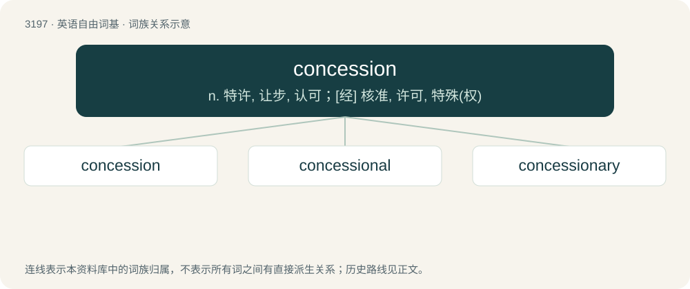

# 3297 · concession — n. 特许, 让步, 认可；\[经\] 核准, 许可, 特殊(权)

[总目录](../00_总目录_按常用程度.md)

**类型**：英语自由词基　｜　**来源语言**：见词源记录

## 核心含义与来源

- 核心含义：n. 特许, 让步, 认可；\[经\] 核准, 许可, 特殊(权)
- 英文含义：The act of conceding.
- 词形：concession

**来源记录 1**（名词；The act of conceding.）

From late Middle English concession, from Middle French concession, from Latin concessiō (“a grant, permission, conceding”), from concēdō. Doublet of concessio.

## 词族图

## 单词速览（常用到不常用）

| 单词 | 音标 | 释义 |
|---|---|---|
| [concession](#w-1) | 英 /kənˈsɛʃən/ | n. 特许, 让步, 认可；\[经\] 核准, 许可, 特殊(权) |
| [concessional](#w-2) | /kənˈseʃənl/ | a. 让步的, 容许的；\[法\] 让步的, 特许的, 优惠的 |
| [concessionary](#w-3) | 美 /kənˈsɛʃəˌnɛɹi/ | a. 让步的, 特许的；n. 特许权获得者 |

## 逐词详解

### 1. concession

**词性**：名词　｜　**音标**：英 /kənˈsɛʃən/

**中文释义**：n. 特许, 让步, 认可；\[经\] 核准, 许可, 特殊(权)

**英文义项**：The act of conceding. / A compromise: a partial yielding to demands or requests.

**词源与演化**：

From late Middle English concession, from Middle French concession, from Latin concessiō (“a grant, permission, conceding”), from concēdō. Doublet of concessio.

**例句**：

> He got the beer concession at the ball park.

该用例对应义项：a contract granting the right to operate a subsidiary business

### 2. concessional

**词性**：形容词　｜　**音标**：/kənˈseʃənl/

**中文释义**：a. 让步的, 容许的；\[法\] 让步的, 特许的, 优惠的

**英文义项**：Of, relating to, or being a concession; concessionary.

**构词拆分**：concession + -al

**词源与演化**：

From concession + -al.

### 3. concessionary

**词性**：名词　｜　**音标**：美 /kənˈsɛʃəˌnɛɹi/

**中文释义**：a. 让步的, 特许的；n. 特许权获得者

**英文义项**：one who owns a concession or a franchise

**构词拆分**：concession + -ary

**词源与演化**：

From concession + -ary.

**例句**：

> I'd like to buy two concessionary tickets.
