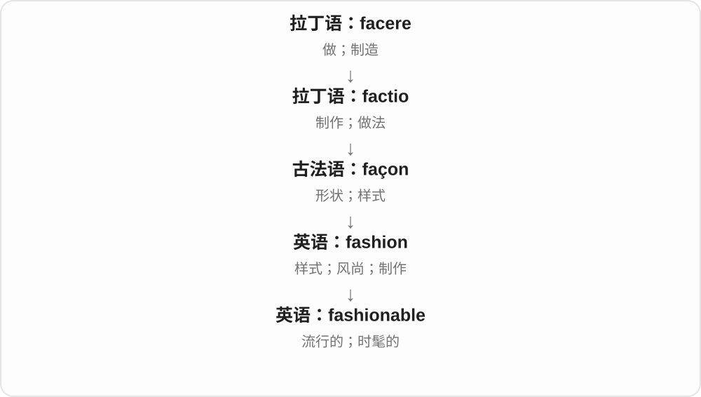

# 3298 · fashionable — 符合或不符合当下潮流，以及表现方式

[逐词精讲目录](../00_逐词精讲目录.md) · [总目录](../00_总目录_按常用程度.md)

## 核心词根与来源

衣着只是一个入口，观点、生活方式也有流行与不流行。用词说明潮流位置，不替代好坏、对错的判断。

**FASHIONABLE：看的是当下流行，不保证永远好看**

fashionable → fashionably；unfashionable 否定流行性质。

- **时尚性质、方式与否定**：fashionable · fashionably · unfashionable

## 词形与演化规律

fashion + -able → fashionable；-able 改 -ably → fashionably；un- 否定。

## 单词速览（按词族由简到繁）

同一基础词的相关扩展放在一起，先读基础形式，再读扩展；各组之间优先读常用的。具体词源关系见各词讲解。

| 单词 | 音标 | 核心意思 |
|---|---|---|
| [fashionable](#w-1) | /ˈfæʃənəbl̩/ | 流行的；时髦的 |
| [fashionably](#w-2) | /ˈfæʃənəbli/ | 时髦地；合时尚地 |
| [unfashionable](#w-3) | /ʌnˈfæʃənəbəl/ | 不时髦的；不流行的 |

## 逐词讲解

### 1. fashionable — 流行的；时髦的

**音标**：/ˈfæʃənəbl̩/

**先抓住这个画面**

橱窗、街头和社交圈里都常见某种样式，人们觉得它跟得上潮流，它就是 fashionable。

**怎么拆**

fashion + -able，表示合乎当前风尚的。

**怎么变成今天的意思**

fashion 是流行样式，形容词把人、衣物或活动放进这种流行之中。也能形容时下受欢迎的观点。

**常见搭配与例句**

fashionable clothes；a fashionable neighbourhood；become fashionable。

> Wide trousers became fashionable again.

宽松长裤又流行起来了。

> It is fashionable to discuss simplicity, but harder to practise it.

谈论简单生活很流行，真正做到却更难。

**别混淆**

stylish 强调有风格、好看；fashionable 强调当下流行，两者并不总一致。

### 2. fashionably — 时髦地；合时尚地

**音标**：/ˈfæʃənəbli/

**先抓住这个画面**

衣服、发型按当下流行风格打理，就是 fashionably dressed。固定说法 fashionably late 常带故意稍晚露面的社交意味。

**怎么拆**

fashionable + -ly；-able 末尾 e 去掉，形成 -ably → fashionably。不是 fashionable 原样再多写一个完整音节。

**怎么变成今天的意思**

**fashion 时尚、方式 + -able → fashionable**  
合时尚的、流行的

↓

**fashionable + -ly；un- + fashionable**  
时髦地；不时髦的

fashionably dressed 穿着时髦；fashionably late 故意稍迟、显得合社交习惯地迟到，常带玩笑或评价语气。

**常见搭配与例句**

fashionably dressed；fashionably late。

> The guests were fashionably dressed.

来宾们穿着时髦。

> He joked that he was fashionably late.

他开玩笑说自己是时髦地晚到了一会儿。

**别混淆**

fashionably late 不是给任何迟到找体面的万能说法；堵车耽误并不天然有故意、摆姿态的意思。

### 3. unfashionable — 不时髦的；不流行的

**音标**：/ʌnˈfæʃənəbəl/

**先抓住这个画面**

现在不受追捧、不符合当下潮流，就是 unfashionable。衣服可以这样说，观点、活动也一样。

**怎么拆**

un- 不 + fashionable 时髦的、流行的；否定整个性质，不表示把时尚主动拆掉。

**怎么变成今天的意思**

**fashion 时尚、方式 + -able → fashionable**  
合时尚的、流行的

↓

**fashionable + -ly；un- + fashionable**  
时髦地；不时髦的

unfashionable clothes 不时髦的衣服；an unfashionable opinion 不流行的观点；become unfashionable 变得不流行。

**常见搭配与例句**

unfashionable clothes；an unfashionable opinion。

> The jacket may be unfashionable, but it is warm and comfortable.

这件夹克或许不时髦，但暖和舒服。

> The essay defends an unfashionable opinion.

文章为一个不流行的观点辩护。

**别混淆**

unfashionable 不流行，不等于 ugly 丑或 wrong 错；审美、流行度和事实判断是不同问题。

## 这一组要分清什么

unfashionable 不自动是丑、错误；fashionably late 是有语境的固定说法，不泛指所有延误。

## 串起来练习

Fashionably dressed people can still enjoy an unfashionable hobby.

穿着时髦的人，也可以喜欢一项不流行的爱好。
