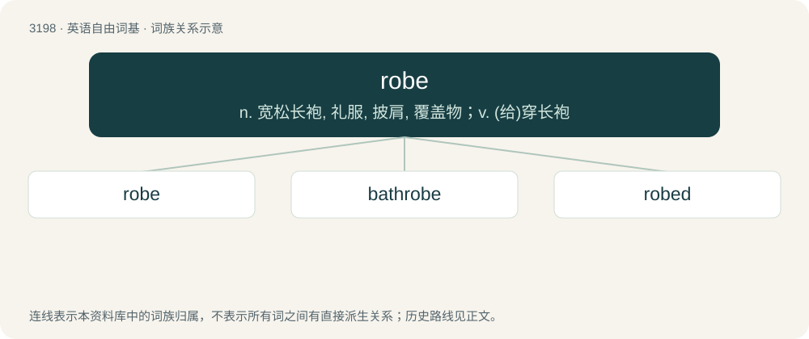

# 3298 · robe — n. 宽松长袍, 礼服, 披肩, 覆盖物；v. (给)穿长袍

[总目录](../00_总目录_按常用程度.md)

**类型**：英语自由词基　｜　**来源语言**：见词源记录

## 核心含义与来源

- 核心含义：n. 宽松长袍, 礼服, 披肩, 覆盖物；v. (给)穿长袍
- 英文含义：A long loose outer garment, often signifying honorary stature.
- 词形：robe

**来源记录 1**（名词；A long loose outer garment, often signifying honorary stature.）

From Middle English robe, roobe, from Old French robe, robbe, reube (“booty, spoils of war, robe, garment”), from Frankish \*rouba, \*rauba (“booty, spoils, stolen clothes”, literally “things taken”), from Proto-Germanic \*raubō, \*raubaz, \*raubą (“booty, that which is stripped or carried away”), from Proto-Indo-European \*Hrewp- (“to tear, peel”). cognates and related terms Akin to Old High German roup (“booty”) (Modern German Raub (“robbery, spoils”)), Old High German roubōn (“to rob, steal”) (Modern German rauben (“to rob”)), Old English rēaf (“spoils, booty, dress, armour, robe, garment”), Old English rēafian (“to steal, deprive”). Cognate with Spanish ropa (“clothing, clothes”). More at rob, reaf, reave.

## 词族图

## 单词速览（常用到不常用）

| 单词 | 音标 | 释义 |
|---|---|---|
| [robe](#w-1) | 英 /ɹəʊb/；美 /ɹoʊb/ | n. 宽松长袍, 礼服, 披肩, 覆盖物；v. (给)穿长袍 |
| [bathrobe](#w-2) | 英 /ˈbɑːθ.ɹəʊb/；美 /ˈbæθ.ɹoʊb/ | n. 浴衣 |
| [robed](#w-3) | /rəʊb/ | n. 长袍, 礼服；制服；vi. 穿长袍；vt. 使穿长袍 |

## 逐词详解

### 1. robe

**词性**：动词　｜　**音标**：英 /ɹəʊb/；美 /ɹoʊb/

**中文释义**：n. 宽松长袍, 礼服, 披肩, 覆盖物；v. (给)穿长袍

**英文义项**：To clothe; to dress. / To put on official vestments.

**词源与演化**：

From Middle English robe, roobe, from Old French robe, robbe, reube (“booty, spoils of war, robe, garment”), from Frankish \*rouba, \*rauba (“booty, spoils, stolen clothes”, literally “things taken”), from Proto-Germanic \*raubō, \*raubaz, \*raubą (“booty, that which is stripped or carried away”), from Proto-Indo-European \*Hrewp- (“to tear, peel”). cognates and related terms Akin to Old High German roup (“booty”) (Modern German Raub (“robbery, spoils”)), Old High German roubōn (“to rob, steal”) (Modern German rauben (“to rob”)), Old English rēaf (“spoils, booty, dress, armour, robe, garment”), Old English rēafian (“to steal, deprive”). Cognate with Spanish ropa (“clothing, clothes”). More at rob, reaf, reave.

**例句**：

> While I was dreaming, a woman in a white robe appeared to me.

### 2. bathrobe

**词性**：名词　｜　**音标**：英 /ˈbɑːθ.ɹəʊb/；美 /ˈbæθ.ɹoʊb/

**中文释义**：n. 浴衣

**英文义项**：A robe usually made of terrycloth intended to be worn when one is still damp from bathing or when there is no immediate need to dress fully.

**构词拆分**：bath + robe

**词源与演化**：

From bath + robe.

**例句**：

> I put on my bathrobe after getting out of the shower.

### 3. robed

**词性**：形容词　｜　**音标**：/rəʊb/

**中文释义**：n. 长袍, 礼服；制服；vi. 穿长袍；vt. 使穿长袍

**英文义项**：Wearing a robe.

**构词拆分**：robe + -ed

**词源与演化**：

From robe + -ed.
