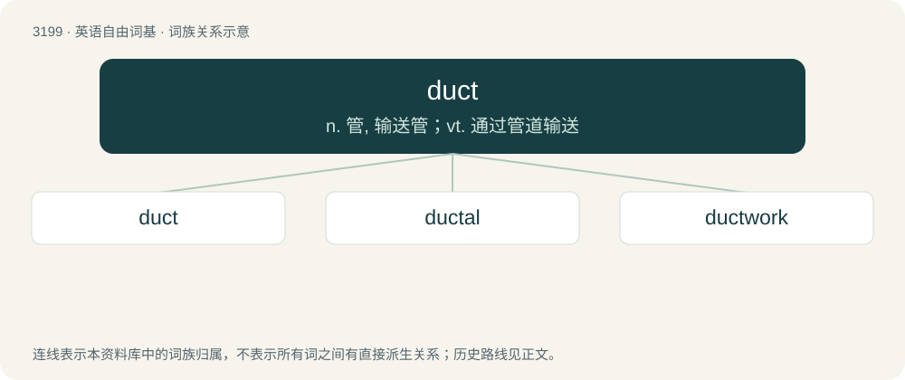

# 3299 · duct — n. 管, 输送管；vt. 通过管道输送

[总目录](../00_总目录_按常用程度.md)

**类型**：英语自由词基　｜　**来源语言**：见词源记录

## 核心含义与来源

- 核心含义：n. 管, 输送管；vt. 通过管道输送
- 英文含义：A pipe, tube or canal which carries gas or liquid from one place to another.
- 词形：duct

**来源记录 1**（名词；A pipe, tube or canal which carries gas or liquid from one place to another.）

Borrowed from Latin ductus (“leading, conducting”, noun), from dūcō (“to lead, conduct, draw”) + -tus (action noun suffix). Doublet of ductus and douit. Also via Medieval Latin ductus (“a conveyance of water; a channel”), which itself has the first mentioned etymology.

## 词族图

## 单词速览（常用到不常用）

| 单词 | 音标 | 释义 |
|---|---|---|
| [duct](#w-1) | /dʌkt/ | n. 管, 输送管；vt. 通过管道输送 |
| [ductal](#w-2) | /ˈdʌktəl/ | \[医\] 管的, 导管的 |
| [ductwork](#w-3) | /ˈdʌktw\\\\ːk/ | n. 管道系统 |

## 逐词详解

### 1. duct

**词性**：名词　｜　**音标**：/dʌkt/

**中文释义**：n. 管, 输送管；vt. 通过管道输送

**英文义项**：A pipe, tube or canal which carries gas or liquid from one place to another. / An enclosure or channel for electrical cable runs, telephone cables, or other conductors.

**词源与演化**：

Borrowed from Latin ductus (“leading, conducting”, noun), from dūcō (“to lead, conduct, draw”) + -tus (action noun suffix). Doublet of ductus and douit. Also via Medieval Latin ductus (“a conveyance of water; a channel”), which itself has the first mentioned etymology.

**用法示例／搭配（非完整句）**：

> heating and air-conditioning ducts

该用例对应义项：A pipe, tube or canal which carries gas or liquid from one place to another.

### 2. ductal

**词性**：形容词　｜　**音标**：/ˈdʌktəl/

**中文释义**：\[医\] 管的, 导管的

**英文义项**：Of, relating to, or originating in a duct.

**构词拆分**：From duct + -al.

**词源与演化**：

From duct + -al.

### 3. ductwork

**词性**：名词　｜　**音标**：/ˈdʌktw\\\\ːk/

**中文释义**：n. 管道系统

**英文义项**：The system of ducts in a particular building.

**构词拆分**：duct + work

**词源与演化**：

From duct + work.
