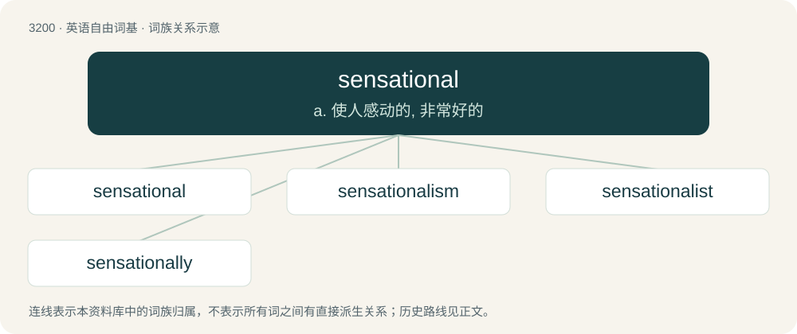

# 3300 · sensational — a. 使人感动的, 非常好的

[总目录](../00_总目录_按常用程度.md)

**类型**：英语自由词基　｜　**来源语言**：见词源记录

## 核心含义与来源

- 核心含义：a. 使人感动的, 非常好的
- 英文含义：Of or pertaining to sensation.
- 词形：sensational

**来源记录 1**（形容词；Of or pertaining to sensation.）

From sensation + -al.

## 词族图

## 单词速览（常用到不常用）

| 单词 | 音标 | 释义 |
|---|---|---|
| [sensational](#w-1) | /sɛnˈseɪʃənəl/ | a. 使人感动的, 非常好的 |
| [sensationalism](#w-2) | /senˈseiʃənəliz(ə)m/ | n. 故意使用的煽情手段, 耸人听闻的题材, 耸人听闻的手法, 危言耸听, 哗众取宠 |
| [sensationalist](#w-3) | /senˈseiʃənəlist/ | n. 爱采用耸人听闻手法的人, 感觉论者 |
| [sensationally](#w-4) | /sɛnˈseɪʃənəli/ | 耸人听闻地 |

## 逐词详解

### 1. sensational

**词性**：形容词　｜　**音标**：/sɛnˈseɪʃənəl/

**中文释义**：a. 使人感动的, 非常好的

**英文义项**：Of or pertaining to sensation. / Piquing or arousing the senses.

**构词拆分**：From sensation + -al.

**词源与演化**：

From sensation + -al.

**用法示例／搭配（非完整句）**：

> sensational nerves

该用例对应义项：Of or pertaining to sensation.

### 2. sensationalism

**词性**：名词　｜　**音标**：/senˈseiʃənəliz(ə)m/

**中文释义**：n. 故意使用的煽情手段, 耸人听闻的题材, 耸人听闻的手法, 危言耸听, 哗众取宠

**英文义项**：The use of sensational subject matter, style or methods, or the sensational subject matter itself; behavior, published materials, or broadcasts that are intentionally controversial, exaggerated, lurid, loud, or attention-grabbing. Especially applied to news media in a pejorative sense that they are reporting in a manner to gain audience or notoriety but at the expense of accuracy and professionalism. / A theory of philosophy that all knowledge is ultimately derived from the senses.

**构词拆分**：sensational + -ism

**词源与演化**：

From sensational + -ism.

**例句**：

> The tabloids relied on sensationalism to maintain their circulation.

该用例对应义项：the journalistic use of subject matter that appeals to vulgar tastes

### 3. sensationalist

**词性**：形容词　｜　**音标**：/senˈseiʃənəlist/

**中文释义**：n. 爱采用耸人听闻手法的人, 感觉论者

**英文义项**：Sensationalistic; tending to sensationalize; characterized by sensationalism (the use of exaggerated or lurid material in order to gain public attention).

**构词拆分**：sensational + -ist

**词源与演化**：

From sensational + -ist.

**例句**：

> It was a sensationalist newspaper, even by tabloid standards.

该用例对应义项：Sensationalistic; tending to sensationalize; characterized by sensationalism (the use of exaggerated or lurid material in order to gain public attention).

### 4. sensationally

**词性**：副词　｜　**音标**：/sɛnˈseɪʃənəli/

**中文释义**：耸人听闻地

**英文义项**：In a sensational manner. / To a sensational extent; amazingly.

**构词拆分**：sensational + -ly

**词源与演化**：

From sensational + -ly.

**例句**：

> In the summer of 1958 the pianist had a sensationally triumphant return.

该用例对应义项：in a sensational manner
