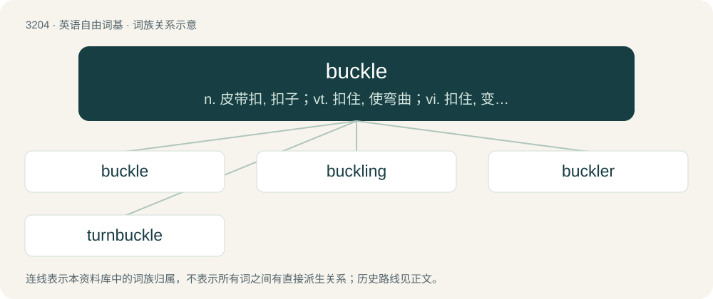

# 3304 · buckle — n. 皮带扣, 扣子；vt. 扣住, 使弯曲；vi. 扣住, 变弯曲, 屈服

[总目录](../00_总目录_按常用程度.md)

**类型**：英语自由词基　｜　**来源语言**：见词源记录

## 核心含义与来源

- 核心含义：n. 皮带扣, 扣子；vt. 扣住, 使弯曲；vi. 扣住, 变弯曲, 屈服
- 英文含义：A metal clasp with a hinged tongue or a spike through which a belt or strap is passed and penetrated by the tongue or spike, in order to fasten the ends of the belt together or to secure the strap to something else.
- 词形：buckle

**多个词源／构词路径**：同一拼写可能有不同来源；以下按词性和含义分别列出。

**来源记录 1**（名词；A metal clasp with a hinged tongue or a spike through which a belt or strap is passed and penetrated by the tongue or spike, in order to fasten the ends of the belt together or to secure the strap to something else.）

The noun is derived from Middle English bokel (“spiked metal ring for fastening; ornamental clasp; boss of a shield; a shield, buckler; (figurative) means of defence”) \[and other forms\], from Old French boucle, bocle (“spiked metal ring for fastening; boss of a shield; a shield”) \[and other forms\], from Latin buccula (“cheek strap of a helmet; boss of a shield”) (from bucca (“soft part of the cheek”)). Noun etymology 1, noun sense 2 (“great conflict or struggle”) is probably derived from verb etymology 1, verb sense 1.2.1 (“to apply (oneself) to, or prepare (oneself) for, a task or work”). The verb is derived from Middle English bokelen, bukelen (“to fasten (something) with a buckle or clasp; to fasten, make fast; to wrap; to arch the body”) \[and other forms\], from bokel (noun) (see above) + -en (suffix forming the infinitive of verbs). In verb etymology 1, verb sense 1.2.1, the sense “to apply (oneself) to, or prepare (oneself) for, a task or work” was derived from the now obsolete sense “to equip (oneself) for a battle, etc.”, and originally alluded to armour being buckled on to the body.

**来源记录 2**（动词；To cause (something) to bend, or to become distorted.）

Origin uncertain. Probably from Middle English bukklen, bokelen (“to arch the body”), from Middle French boucler (“to bulge”, literally “to take the shape of a shield boss”), perhaps from the same ultimate origin as Etymology 1 above, or perhaps related to Middle Low German bockelen (“to bang out curves in metal”), German buckeln (“to bend over, hunch”). In some senses, possibly from buck (“to bend, yield, buckle”) + -le (frequentative suffix).

## 词族图

## 单词速览（常用到不常用）

| 单词 | 音标 | 释义 |
|---|---|---|
| [buckle](#w-1) | /ˈbʌkəl/ | n. 皮带扣, 扣子；vt. 扣住, 使弯曲；vi. 扣住, 变弯曲, 屈服 |
| [buckling](#w-2) | /ˈbʌk.əl.ɪŋ/ | \[化\] 屈曲 |
| [buckler](#w-3) | 英 /ˈbʌk.lə/；美 /ˈbʌk.lɚ/ | n. 小圆盾, 防卫物, 防卫；vt. 以盾防护, 防卫 |
| [turnbuckle](#w-4) | /ˈtəːn.bʌkl/ | n. 松紧螺旋扣；\[机\] 松紧螺旋扣 |

## 逐词详解

### 1. buckle

**词性**：名词　｜　**音标**：/ˈbʌkəl/

**中文释义**：n. 皮带扣, 扣子；vt. 扣住, 使弯曲；vi. 扣住, 变弯曲, 屈服

**英文义项**：A metal clasp with a hinged tongue or a spike through which a belt or strap is passed and penetrated by the tongue or spike, in order to fasten the ends of the belt together or to secure the strap to something else. / Some other form of clasp used to fasten two things together.

**词源与演化**：

The noun is derived from Middle English bokel (“spiked metal ring for fastening; ornamental clasp; boss of a shield; a shield, buckler; (figurative) means of defence”) \[and other forms\], from Old French boucle, bocle (“spiked metal ring for fastening; boss of a shield; a shield”) \[and other forms\], from Latin buccula (“cheek strap of a helmet; boss of a shield”) (from bucca (“soft part of the cheek”)). Noun etymology 1, noun sense 2 (“great conflict or struggle”) is probably derived from verb etymology 1, verb sense 1.2.1 (“to apply (oneself) to, or prepare (oneself) for, a task or work”). The verb is derived from Middle English bokelen, bukelen (“to fasten (something) with a buckle or clasp; to fasten, make fast; to wrap; to arch the body”) \[and other forms\], from bokel (noun) (see above) + -en (suffix forming the infinitive of verbs). In verb etymology 1, verb sense 1.2.1, the sense “to apply (oneself) to, or prepare (oneself) for, a task or work” was derived from the now obsolete sense “to equip (oneself) for a battle, etc.”, and originally alluded to armour being buckled on to the body.

**例句**：

> I've really got to buckle down and study for our final exams.

### 2. buckling

**词性**：名词　｜　**音标**：/ˈbʌk.əl.ɪŋ/

**中文释义**：\[化\] 屈曲

**英文义项**：The act of fastening a buckle. / A folding into hills and valleys.

**构词拆分**：buckle + -ing

**词源与演化**：

From the verb to buckle, equivalent to buckle + -ing.

### 3. buckler

**词性**：名词　｜　**音标**：英 /ˈbʌk.lə/；美 /ˈbʌk.lɚ/

**中文释义**：n. 小圆盾, 防卫物, 防卫；vt. 以盾防护, 防卫

**英文义项**：One who buckles something. / A kind of shield, of various shapes and sizes, held in the hand or worn on the arm (usually the left), for protecting the front of the body. In the sword and buckler play of the Middle Ages in England, the buckler was a small shield, used not to cover the body but to stop or parry blows.

**构词拆分**：buckle + -er

**词源与演化**：

From Middle English bukler, bokler, bokeler, bokeleer, from Old French bocler, boucler, bucler, (French bouclier) from Vulgar Latin \*bucculārius (“bossed”), from Latin buccula (“boss”). Merged with buckle + -er.

**例句**：

> With this parchment that should be his buckler against any future need, Sir Oliver rode home, uplifted.

### 4. turnbuckle

**词性**：名词　｜　**音标**：/ˈtəːn.bʌkl/

**中文释义**：n. 松紧螺旋扣；\[机\] 松紧螺旋扣

**英文义项**：A coupling device consisting of two eyelets or other connection points connected in screw threads. / A link threaded on both ends of a short bar which is used to pull objects together.

**构词拆分**：turn + buckle

**词源与演化**：

From turn + buckle.

**例句**：

> A player who is checked into the turnbuckles may be injured.

该用例对应义项：The area at either end of a bench where the edge of the glass is padded and meets the boards at a right angle.
