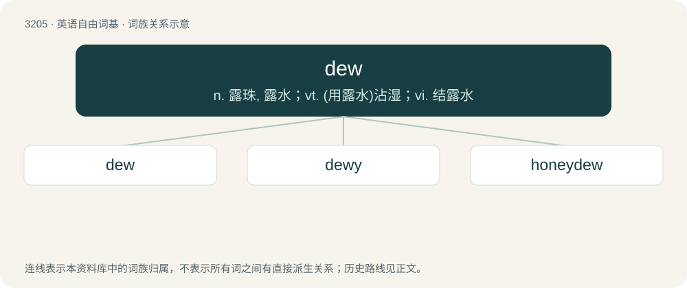

# 3305 · dew — n. 露珠, 露水；vt. (用露水)沾湿；vi. 结露水

[总目录](../00_总目录_按常用程度.md)

**类型**：英语自由词基　｜　**来源语言**：见词源记录

## 核心含义与来源

- 核心含义：n. 露珠, 露水；vt. (用露水)沾湿；vi. 结露水
- 英文含义：Any moisture from the atmosphere condensed by cool bodies upon their surfaces.
- 词形：dew

**多个词源／构词路径**：同一拼写可能有不同来源；以下按词性和含义分别列出。

**来源记录 1**（名词；Any moisture from the atmosphere condensed by cool bodies upon their surfaces.）

From Middle English dew, from Old English dēaw (“dew”), from Proto-West Germanic \*dauw, from Proto-Germanic \*dawwaz, \*dawwą (“dew, moisture”), from Proto-Indo-European \*dʰewh₂- (“smoke, haze”). Cognate with German Tau, Dutch dauw and Afrikaans dou. Doublet of dag.

**来源记录 2**（动词；To wet with, or as if with, dew; to moisten.）

From Middle English dewe, dewen, from Old English \*dēawian, from Proto-West Germanic \*dauwēn, from Proto-Germanic \*dawwāną. Cognates include Saterland Frisian daue, German tauen and Dutch dauwen.

## 词族图

## 单词速览（常用到不常用）

| 单词 | 音标 | 释义 |
|---|---|---|
| [dew](#w-1) | /d͡ʒuː/ | n. 露珠, 露水；vt. (用露水)沾湿；vi. 结露水 |
| [dewy](#w-2) | /ˈdjuː.i/ | a. 露湿的, 带露水的, 如露的 |
| [honeydew](#w-3) | 英 /ˈhʌnɪdjuː/；美 /ˈhʌniˌd(j)u/ | n. 蜜汁, 蜜露 |

## 逐词详解

### 1. dew

**词性**：名词　｜　**音标**：/d͡ʒuː/

**中文释义**：n. 露珠, 露水；vt. (用露水)沾湿；vi. 结露水

**英文义项**：Any moisture from the atmosphere condensed by cool bodies upon their surfaces. / Moisture in the air that settles on plants, etc in the morning or evening, resulting in drops.

**词源与演化**：

From Middle English dew, from Old English dēaw (“dew”), from Proto-West Germanic \*dauw, from Proto-Germanic \*dawwaz, \*dawwą (“dew, moisture”), from Proto-Indo-European \*dʰewh₂- (“smoke, haze”). Cognate with German Tau, Dutch dauw and Afrikaans dou. Doublet of dag.

**例句**：

> There was a heavy dew this morning.

该用例对应义项：An instance of such moisture settling on plants, etc.

### 2. dewy

**词性**：形容词　｜　**音标**：/ˈdjuː.i/

**中文释义**：a. 露湿的, 带露水的, 如露的

**英文义项**：Covered by dew. / Having the quality of bearing droplets of water.

**构词拆分**：dew + -y

**词源与演化**：

From Middle English dewy, deuhy, from Old English dēawiġ, from Proto-West Germanic \*dauwag, \*dauwīg, equivalent to dew + -y.

**例句**：

> The dewy grass was too slick for football.

该用例对应义项：Covered by dew.

### 3. honeydew

**词性**：名词　｜　**音标**：英 /ˈhʌnɪdjuː/；美 /ˈhʌniˌd(j)u/

**中文释义**：n. 蜜汁, 蜜露

**英文义项**：A sweet, sticky substance deposited on leaves and other plant parts by insects (especially aphids and scale insects) feeding on plant sap, or by fungi. / A sweet liquid substance resembling the substance mentioned in sense 1, such as honey, nectar, or manna in the Bible.

**构词拆分**：honey + dew

**词源与演化**：

The noun is derived from honey + dew, originally believed to be a form of dew that fell from the sky like rain onto plants (see sense 1). The adjective is derived from the noun.

**例句**：

> She'd like to have honeydew melon for dessert.
